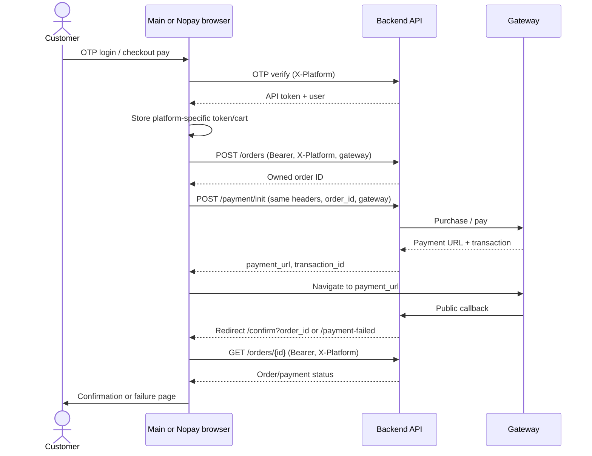

# ZIOTO B1: cross-repository frontend compatibility audit

Audit date: 2026-11-11. Scope: repository source at `zioto-new-backend` and `zioto-new-frontend`; no runtime, production configuration, deployed revision, database, or gateway was inspected. **CONFIRMED** means directly supported by these files, **INFERRED** means a source-based expectation, and **UNVERIFIED** needs runtime or external evidence. This report is analysis only; B1 is not implemented.

## 1. Executive Summary

**CONFIRMED:** Both executable payment-init callers in the inspected frontend are client-side checkout actions. They create an order with the shared API client, then call the same client's `POST /payment/init` with the returned order ID. That client reads the platform-specific bearer token from browser storage and adds `X-Platform` to both requests (`frontend/src/lib/api-client.ts:17-37,221-230,266-276`; `frontend/src/app/pages/CheckoutPage.tsx:513-523`; `frontend/src/app/nopay/checkout/page.tsx:794-803`). Order creation already requires `auth.token` (`backend/routes/api.php:70`). Normal, valid-session checkout therefore fits the proposed B1 authorization.

**CONFIRMED:** The backend currently leaves init public and accepts any existing order ID before purchasing a gateway invoice (`backend/routes/api.php:124-129`; `backend/app/Http/Requests/InitPaymentRequest.php:9-18`; `backend/app/Http/Controllers/Api/PaymentController.php:100-105,201-235`). B1 should be enforced before any payment attempt or gateway call.

**CONDITIONAL GO:** Source-level main and Nopay checkouts are compatible, but rollout requires the isolated regression matrix below and verification that deployed frontend/mobile/legacy callers use these same authenticated headers. A confirmed main-site reauthentication return-path defect needs a small frontend fix or an explicit acceptance of degraded recovery before rollout: token expiry sends `returnTo`, while main login only reads `redirect` (`frontend/src/lib/token-expired.ts:9-13`; `frontend/src/app/pages/AuthPage.tsx:12-15`). This defect is most likely encountered on a new 401 from init; it does not make normal valid-token checkout incompatible.

## 2. Frontend Technology and Architecture

**CONFIRMED:** `frontend/package.json` declares Next `^16.2.9`, React/React DOM `^18.3.1`, TypeScript and SWR; no Axios dependency. `frontend/src/app` uses App Router. `frontend/src/app/layout.tsx:28-90` mounts `Providers`; `frontend/src/app/context/Providers.tsx:114-121` mounts `AuthProvider`. The custom `fetch` wrapper calls `NEXT_PUBLIC_API_URL` or a localhost fallback directly from client-side payment actions (`frontend/src/lib/api-client.ts:5,17-48`). These are declared ranges, not proof of production installed versions.

**CONFIRMED:** `frontend/src/proxy.ts:25-45` rewrites `pay.sawiss.com` clean paths to `/nopay/*` within this Next application. No executable payment-init server action or API proxy route was found in `frontend/src/app`; the two checkout call sites are browser actions. **UNVERIFIED:** Deployed host mapping, environment values, release parity, other frontend repositories, PWA caches and native clients.

## 3. Authentication and Token Lifecycle

**CONFIRMED:** OTP verification or Shahkar registration stores the API token and user in platform-specific `localStorage` keys (`frontend/src/lib/auth.tsx:66-98`; `frontend/src/lib/platform.ts:34-42`). `AuthProvider` restores them after hydration (`frontend/src/lib/auth.tsx:45-57`), and the API wrapper rereads the token for each request (`frontend/src/lib/api-client.ts:17-27`). There is no refresh-token path in these inspected files. Backend `AuthenticateApiToken` accepts a bearer hash for the header-selected platform and rejects missing, invalid and older-than-72-hour tokens with distinct 401 codes (`backend/app/Http/Middleware/AuthenticateApiToken.php:16-45`).

**CONFIRMED:** Browser storage survives a same-browser gateway round trip unless cleared, but is origin-specific. A second device/browser lacks that token. The gateway callback itself remains public (`backend/routes/api.php:126-127`); the frontend confirmation page uses authenticated order detail afterward (`frontend/src/app/pages/ConfirmPage.tsx:22-42`; `frontend/src/app/nopay/confirm/page.tsx:23-45`). **INFERRED:** A user returning without a valid token may see the payment-failed page even after payment because order-detail lookup fails; B1 does not change this callback behavior.

**CONFIRMED:** `AuthProvider` sets `isAuthenticated` when either token *or* user exists; it restores a saved token only inside the saved-user branch (`frontend/src/lib/auth.tsx:45-55,121`). Stale user data can pass the UI guard without a usable bearer token; authenticated order creation already rejects such a request. This is a pre-existing state mismatch.

## 4. API Client and Request Headers

**CONFIRMED:** `request()` adds JSON `Content-Type`, `Accept`, `X-Platform`, and conditional `Authorization: Bearer <token>`, then uses `fetch` with `credentials: "omit"` (`frontend/src/lib/api-client.ts:17-37`). Payment init passes method/body and no overriding headers (`:272-276`); its expected success shape is `{payment_url, transaction_id}`. This means the payment-init request is authenticated if a token for that browser platform is present; there are no cookies to fall back to. The caller consumes `payment_url`; `transaction_id` is typed but unused by the checkout pages.

**CONFIRMED:** On 401 with `TOKEN_EXPIRED`, `TOKEN_INVALID` or `TOKEN_MISSING`, the wrapper clears the current platform's token/user and redirects to auth before throwing `ApiError`; other failures surface the response message or first validation error (`frontend/src/lib/api-client.ts:39-48`; `frontend/src/lib/token-expired.ts:3-13`). `options` spreads after `headers`, so callers that supply `options.headers` can override assembled headers; payment.init does not (`frontend/src/lib/api-client.ts:29-37,272-276`).

## 5. Payment Initiation Call Sites

The full frontend text search included `/payment/init`, `payment/init`, `initPayment`, `init_payment`, `paymentUrl`, `payment_url`, `transaction_id`, `order_id`, `Authorization`, `Bearer`, and `X-Platform`, excluding lock files. **CONFIRMED:** Only the two executable `api.payment.init` calls below and its shared definition were found. The `api.payment.status` definition at `frontend/src/lib/api-client.ts:277-278` has no inspected caller; success pages instead call `api.orders.show`.

| Caller and trigger | Request, credentials, response | Failure and retry |
| --- | --- | --- |
| **Main:** pay button in `frontend/src/app/pages/CheckoutPage.tsx:478-510,513-523,948-975`. Gateway selected from Parsian, optional Digipay, Smartis, Kamanlend. | `POST /api/payment/init` body `{order_id: orderResult.order.id, gateway}`. Shared client reads `zioto_token` and sends `X-Platform: main` on main host; expects `{payment_url,transaction_id}` and navigates to `payment_url` (`frontend/src/lib/api-client.ts:17-37,272-276`; `frontend/src/lib/platform.ts:16-49`). | Catch displays identity modal for specified identity codes, otherwise toast; loading resets (`CheckoutPage.tsx:478-510`). A second click creates a new order; failure page links to checkout/orders, not direct same-order init (`PaymentFailedPage.tsx:18-25`). |
| **Nopay:** installment pay button in `frontend/src/app/nopay/checkout/page.tsx:775-816`. | Same method/client, body `{order_id: orderResult.order.id,gateway:"nopay"}`; browser host or `/nopay` path selects `nopay_token` and `X-Platform: nopay` (`frontend/src/lib/platform.ts:16-49`). Redirects to returned `payment_url`. | Identity-specific modal or generic toast; loading resets (`nopay/checkout/page.tsx:804-816`). Failure page links to cart/home and clears local cart (`nopay/payment-failed/page.tsx:8-43`); no direct same-order init found. |

## 6. Complete Checkout Sequence

**CONFIRMED:** Guest cart is stored locally and synchronized after login if a token exists (`frontend/src/hooks/useCart.ts:9-24,38-86`). Both checkout pages redirect unauthenticated users to auth (`frontend/src/app/pages/CheckoutPage.tsx:183-187`; `frontend/src/app/nopay/checkout/page.tsx:122-128`). Main checkout sends the selected gateway during order creation and passes the returned ID to init (`CheckoutPage.tsx:513-523`); Nopay does the same with `gateway:"nopay"` (`nopay/checkout/page.tsx:794-803`). The backend creates orders for `$request->user()->id` and request platform (`backend/app/Http/Controllers/Api/OrderSubmitController.php:97-100,414-423`). Backend callback redirects to `/confirm?order_id=...` or `/payment-failed` on a gateway-specific configured frontend origin (`backend/app/Http/Controllers/Api/PaymentController.php:183-193,732-737` and callback redirects at `:315,363,430,457,595-602`). Confirmation checks `payment_status === "paid"` through `api.orders.show` (`frontend/src/app/pages/ConfirmPage.tsx:25-40`; `frontend/src/app/nopay/confirm/page.tsx:26-45`).

**INFERRED:** The request sequence should use the same platform token and platform header because both operations call the same wrapper in one browser action. A token can still expire or be removed between calls. No gateway traffic was executed in this audit.

## 7. Payment Gateway Compatibility Matrix

| Gateway | Inspected initiator and auth | Special path / risk |
| --- | --- | --- |
| Parsian | **CONFIRMED:** Main `CheckoutPage.tsx:948-953,513-523`; shared bearer and `X-Platform: main`. | Backend uses gateway callback URL and main frontend URL (`PaymentController.php:179-193,732-737`). Normal valid token compatible; new 401 if token missing. |
| Digipay | **CONFIRMED:** Same main path, visible only if `ENABLE_DIGIPAY` (`CheckoutPage.tsx:948-953`; `frontend/src/lib/feature-flags.ts:3-4`). | Installment eligibility and provider runtime unverified; no special frontend init caller. |
| Kamanlend | **CONFIRMED:** Same main path (`CheckoutPage.tsx:952,513-523`). | No special frontend init caller; gateway runtime unverified. |
| Smartis | **CONFIRMED:** Same main path (`CheckoutPage.tsx:951,513-523`). | No special frontend init caller; gateway runtime unverified. |
| Nopay | **CONFIRMED:** Same repository, dedicated Nopay checkout (`nopay/checkout/page.tsx:794-803`), `nopay_token` / `X-Platform: nopay`; host rewrite at `frontend/src/proxy.ts:25-45`. | Backend Nopay may use configured bare callback URL (`PaymentController.php:177-181`), and uses Nopay frontend return origin (`:732-737`). Verify deployed host/revision and callback registration before rollout. |

**CONFIRMED:** The backend validation lists all five gateways (`backend/app/Http/Requests/InitPaymentRequest.php:18`). This matrix establishes frontend request compatibility, not gateway service compatibility. Existing 422 states include paid/expired/cancelled/processing orders and Nopay eligibility (`PaymentController.php:106-163`); B1 adds ownership rejection before reaching them.

## 8. Platform Binding Analysis

**CONFIRMED:** Browser hostname or `/nopay` path determines header and storage key (`frontend/src/lib/platform.ts:16-49`). Backend `Platform::fromRequest()` accepts `main`, `nopay`, `tapsi` and defaults unknown/missing headers to `main` (`backend/app/Support/Platform.php:19-38`). `AuthenticateApiToken` looks up a user by both token hash and selected platform (`backend/app/Http/Middleware/AuthenticateApiToken.php:24-35`). Order creation sets `user_id` from the authenticated user and platform from the request (`backend/app/Http/Controllers/Api/OrderSubmitController.php:97-100,414-423`).

**CONFIRMED:** `X-Platform` is client-controlled; hostname detection is frontend convenience, not server-side authorization. B1 must compare the authenticated user's ID **and** the order's platform to the authenticated/request platform. A main token with a forged `nopay` header cannot authenticate as the main user through this middleware; an order ID must never substitute for an ownership check. The backend also has a `tapsi` platform with no caller in this inspected frontend; **UNVERIFIED** external Tapsi callers and their token/header behavior.

## 9. Payment Retry and Expired Token Scenarios

| Scenario | Existing behavior | Expected B1 impact / minimum handling |
| --- | --- | --- |
| Main retry after gateway failure | **CONFIRMED:** Failure page sends user to checkout or orders; checkout creates a fresh order on pay (`frontend/src/app/pages/PaymentFailedPage.tsx:18-25`; `CheckoutPage.tsx:513-523`). | Valid bearer still works. No direct same-order frontend retry. Existing pending/processing order rules remain (`backend/PaymentController.php:135-152`). Test a fresh order after failure. |
| Nopay retry | **CONFIRMED:** Failure page deletes local Nopay cart, despite its cart button (`frontend/src/app/nopay/payment-failed/page.tsx:11-43`). | Pre-existing recovery risk, not caused by B1; do not alter under B1. Test and document current behavior. |
| Expiry between order creation and init | **CONFIRMED:** 401 token handler clears storage and navigates to login (`frontend/src/lib/api-client.ts:39-45`; `token-expired.ts:3-13`). | New possible 401 point. Main auth reads `redirect`, not `returnTo`, so login returns home rather than checkout (`AuthPage.tsx:12-15`); Nopay reads `returnTo` (`nopay/auth/page.tsx:16-34`). Smallest frontend fix: make main auth accept `returnTo` with the existing `redirect` behavior, restricting return destinations to the same origin; test preserved cart and no duplicate paid order. |
| Return from gateway without token / another device | **CONFIRMED:** Confirmation uses authenticated `orders.show`; its failure catch navigates to payment-failed (`ConfirmPage.tsx:25-40`; `nopay/confirm/page.tsx:26-45`). | B1 does not change callback, but frontend may mislabel a paid order as failed. Treat as existing UX dependency; test separately. Never make callback or order detail public to accommodate it. |
| Pending/expired order supplied to init | **CONFIRMED:** Controller rejects processing, paid, cancelled or expired orders (`backend/PaymentController.php:106-111,135-141`). | Ownership should be checked first. Same owner's invalid state keeps existing 422 contract; foreign IDs must not reveal state. |

## 10. B1 Backend Change Compatibility

**CONFIRMED:** Adding `auth.token` only to `POST /api/payment/init` matches the existing checkout credential pattern and leaves public callback routes untouched (`backend/routes/api.php:124-129`; `frontend/src/lib/api-client.ts:17-37`). An unauthorized/missing token will now get middleware 401; a foreign or cross-platform order should be rejected before mutation or gateway purchase. Preserve successful JSON keys and gateway-specific callback URLs (`backend/PaymentController.php:177-235`).

**INFERRED:** The smallest safe implementation is the already proposed B1 plan's route middleware plus request/order lookup bound to `request->user()->id` and the selected platform. Avoid relying only on the global tenant scope or only on a validation `exists` rule. Choose a non-disclosing 404/422 policy for foreign order IDs consistently with project conventions and test exact response contract. No B2–B5/C1 change is needed. **UNVERIFIED:** Any older client that posts only an order ID without bearer credentials will break; do not exempt it from ownership enforcement.

## 11. Required Frontend Changes

**CONFIRMED:** No change is required for valid-session main or Nopay payment-init requests in this inspected source. The shared client already sends both headers.

**CONDITIONAL:** Correct main login's expired-token return path before or with B1 rollout: accept the `returnTo` query used by `handleTokenExpired()` (while retaining `redirect`), validate that it resolves to the same site, and return the user to checkout. Preserve existing OTP success behavior. A targeted frontend test should cover a 401 at init after a successful order creation. Do not introduce a new auth method or duplicate order creation retry automatically. The stale `isAuthenticated` state and Nopay failure-cart clearing are existing issues; track separately rather than expanding B1.

## 12. Required Backend Changes

**PROPOSED, NOT APPLIED:** Add `auth.token` to the init route only; scope validation and the controller order lookup to authenticated owner ID plus platform; reject before payment mutation/purchase; retain current body (`order_id`, `gateway`), success response (`payment_url`, `transaction_id`), existing state errors for the owner, and all callback routes and provider handling (`backend/routes/api.php:124-129`; `backend/app/Http/Requests/InitPaymentRequest.php:9-29`; `backend/app/Http/Controllers/Api/PaymentController.php:100-235`). The detailed proposed diff and backend regression plan remain in `backend/docs/ZIOTO_B1_AUTHORIZATION_PLAN.md`; re-check it against current source before implementation. In particular, authorize the exact owner/platform using the middleware-resolved user, never request body `user_id` or a browser-supplied platform as sole proof.

## 13. Side Effects and Regression Risks

| Concern | Current source / B1 behavior | Risk and minimum test or remedy |
| --- | --- | --- |
| Normal checkout and installments | **CONFIRMED:** All five gateways use one of two shared-client checkout paths. B1 validates bearer/owner. | Low source-level risk with valid session; test each gateway with faked purchase and unchanged response. |
| Guest browsing, OTP, saved cart | **CONFIRMED:** Local cart then post-login synchronization (`frontend/src/hooks/useCart.ts:38-86`); checkout redirects to auth. | Test guest-to-login-to-checkout, including Nopay host. No guest init path is visible. |
| Login recovery | **CONFIRMED:** Main `returnTo`/`redirect` mismatch. | A new init 401 may strand user at home; fix main auth parameter handling and test same-origin redirect. |
| Error messages / loading | **CONFIRMED:** Both checkout catches show generic toast for 401/422 and reset loading (`CheckoutPage.tsx:478-510`; `nopay/checkout/page.tsx:804-816`). | Unexpected 422 may look like payment failure. Test denied ID error and loading reset; auth 401 must trigger reauth. |
| Pending/expired/paid orders | **CONFIRMED:** Existing controller rejects those states. | Verify owner still receives same state response; foreign user cannot distinguish states or create attempt. |
| Gateway return / mobile / PWA | **CONFIRMED:** callback is public; confirmation requires token. **UNVERIFIED:** alternate browser, cached frontend release, PWA runtime. | Test same-browser mobile viewport and token-cleared return without real gateway; document existing paid-order display behavior. |
| Contract and redirects | **CONFIRMED:** Request and success JSON plus callback destinations are defined in source. | Assert unchanged JSON/URL for owner and unchanged public callbacks. No real gateway test. |

## 14. Automated Test Recommendations

**PROPOSED:** In an isolated backend test DB, use PHPUnit feature tests with fake gateway/payment services: valid owner on each platform; main owner via each supported gateway; Nopay owner; missing/invalid/expired bearer 401; other user on same platform; main token with Nopay order, Nopay token with main order, forged/missing/unknown `X-Platform`, and any Tapsi account/order fixture. Assert foreign IDs cause no payment row change or gateway purchase, and owner success keeps `payment_url`/`transaction_id`. Assert public callback route middleware is unchanged. Test existing paid/cancelled/expired/processing responses for the owner. Never call a real provider.

**PROPOSED:** Frontend tests with mocked `fetch` and browser storage should assert main and Nopay order-create/init requests carry the same bearer and platform, checkout redirects to returned `payment_url`, 401 clears only current-platform keys and returns to checkout after login, 422 shows error and resets loading, and guest cart survives OTP login. For each gateway selection, assert gateway string and order ID in init. Mock a gateway return to confirmation/failure pages and exercise token-present versus token-missing behavior. No tests or builds were run during this read-only audit.

## 15. Safe Implementation Order

1. **UNVERIFIED gate:** Inventory deployed frontend revision, cached PWA/mobile builds and any legacy/Tapsi consumers of init; establish whether each sends bearer and matching `X-Platform`.
2. **CONFIRMED source fix to schedule:** Repair main auth's `returnTo` recovery with targeted frontend tests; no broader checkout redesign.
3. Add isolated backend ownership/platform tests and fake gateway assertions, then apply only the B1 route/request/controller change.
4. Run focused frontend and backend tests in isolated environments; manually inspect main/Nopay checkout with mocked gateway redirects.
5. Stage the backend/frontend revisions together and verify 401, owner success, cross-platform denial and public callbacks before production rollout.

## 16. Deployment and Rollback Strategy

**PROPOSED:** Deploy a frontend with corrected reauthentication recovery first, confirm the active main/Nopay host mapping and build versions, then release the narrow backend B1 change in a controlled window. Monitor init 401/authorization-denial/422 rates by platform and gateway, checkout completion, and callback completion without logging bearer values. Verify no unsupported legacy caller is being silently rejected. Preserve public callbacks and response shape throughout.

**PROPOSED:** If legitimate payment initiation fails after release, stop rollout and restore the previous backend revision while investigating the caller and platform header; this temporarily reopens B1, so keep the rollback window short and restrict exposure operationally. Do not weaken owner checks or add a permanent unauthenticated bypass. A frontend-only rollback of the recovery fix is unnecessary unless it causes its own regression. No deployment or rollback was performed.

## 17. Unknowns and External Dependencies

**UNVERIFIED:** Production frontend/backend revision parity; `NEXT_PUBLIC_API_URL` and Nopay host values; existing external mobile, PWA, Tapsi or legacy clients; traffic mix by gateway; actual token expiry distribution; gateway merchant callback registration; provider behavior under test; CDN/service-worker cache behavior; operational monitoring; whether any customer reopens payment on another device. This repository audit cannot establish production safety or zero side effects. The frontend's Nopay source is available here, but deployed Nopay parity remains unverified.

## 18. Final Go / No-Go Recommendation

**CONDITIONAL GO.** **CONFIRMED:** The currently inspected main and Nopay source sends a platform-selected bearer and `X-Platform` through the shared API wrapper for both authenticated order creation and payment initiation, and all five listed gateway selections reach these two callers. Thus the narrow B1 authorization is compatible with the normal valid-session checkout shown here. **Required before production release:** fix or explicitly accept the main reauthentication return-path defect, pass isolated owner/unauthorized/cross-platform/provider contract tests, and verify deployed plus legacy/Tapsi caller inventory. **UNVERIFIED:** Production-wide compatibility. Implementing backend authorization now in an isolated branch/test environment is reasonable; deploying it without these gates is not.

## 19. Evidence: Relevant Source Files and Methods

| Area | Source references |
| --- | --- |
| Backend route/auth | `backend/routes/api.php:66-70,122-129`; `backend/app/Http/Middleware/AuthenticateApiToken.php:16-45`; `backend/app/Support/Platform.php:19-38` |
| Backend order/init/callback | `backend/app/Http/Controllers/Api/OrderSubmitController.php:97-100,414-423`; `backend/app/Http/Requests/InitPaymentRequest.php:9-29`; `backend/app/Http/Controllers/Api/PaymentController.php:100-235,732-737` |
| Frontend shared client/auth | `frontend/src/lib/api-client.ts:5-48,221-235,266-279`; `frontend/src/lib/auth.tsx:45-57,66-121`; `frontend/src/lib/platform.ts:16-49`; `frontend/src/lib/token-expired.ts:3-13` |
| Frontend main | `frontend/src/app/pages/CheckoutPage.tsx:183-207,478-523,948-975`; `frontend/src/app/pages/AuthPage.tsx:9-15`; `frontend/src/app/pages/ConfirmPage.tsx:22-42`; `frontend/src/app/pages/PaymentFailedPage.tsx:18-25` |
| Frontend Nopay | `frontend/src/proxy.ts:25-45`; `frontend/src/app/nopay/auth/page.tsx:16-34`; `frontend/src/app/nopay/checkout/page.tsx:122-128,775-816`; `frontend/src/app/nopay/confirm/page.tsx:23-45`; `frontend/src/app/nopay/payment-failed/page.tsx:8-43` |
| Frontend cart / package | `frontend/src/hooks/useCart.ts:9-24,38-89`; `frontend/package.json` |

Paths prefixed `frontend/` mean `/Users/mehdi/Documents/ZiotoNewProjects/zioto-new-frontend/`; paths prefixed `backend/` mean `/Users/mehdi/Documents/ZiotoNewProjects/zioto-new-backend/`.
