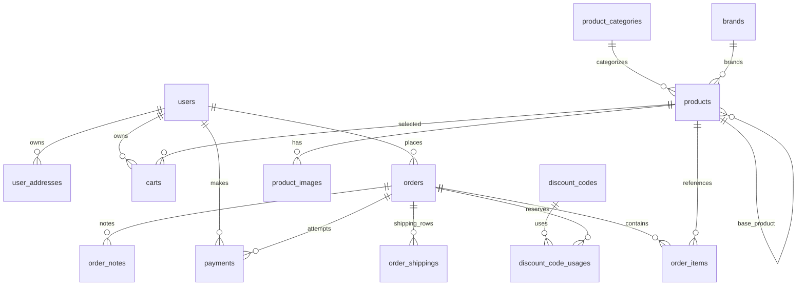

# Zioto Financial Core: commerce backend discovery

**Method and scope.** Static inspection of the repository on 2026-11-11. No database connection, customer record, external API, payment request, migration, or test was executed. “Confirmed” means supported by source, not verified in a deployed environment. Migration inventory describes the intended final schema if all migrations ran; actual deployment drift is unknown. This document proposes integration boundaries, not an implementation or a full Financial Core design.

## 1. Executive Summary

The backend is a Laravel 13 modular commerce application with a relational commerce database, optional MongoDB logs/history, a custom bearer-token API, and five configured payment gateways. Orders and payments are stored in Commerce. Precious-metal prices are fetched from external sources, cached, recalculated, and snapshotted into order items at submission. Stock is synchronized from Hesabfa, with a separate reservation observer. There is **no identified wallet, ledger, deposit, withdrawal, bank-account, OTC trade, or financial reconciliation subsystem** in application code or migrations. These observations follow `composer.json`, `routes/api.php`, `app/Services/Pricing/DynamicPriceService.php`, `app/Http/Controllers/Api/OrderSubmitController.php`, and the migration inventory below.

The first integration blocker is confirmed: `POST /api/payment/init` has no authentication middleware, `InitPaymentRequest::authorize()` returns true, and `PaymentController::init()` loads an order by supplied ID without ownership validation (`routes/api.php`, `app/Http/Requests/InitPaymentRequest.php`, `app/Http/Controllers/Api/PaymentController.php::init`). A wallet payment path must establish authenticated user ownership and server-to-server authorization before reserving funds. Commerce should own orders and physical fulfillment; Financial Core should exclusively own balances, ledger postings, holds, trading, bank accounts, and reconciliation.

## 2. Technology Stack

| Area | Confirmed finding | Evidence |
|---|---|---|
| Runtime | `composer.json` requires PHP `^8.3`; host context says PHP 8.5. Installed Laravel is 13.35.0, Filament 5.10.0, Modules 13.0.0, Multipay 2.11.0, Spatie Permission 8.3.0, MongoDB Laravel 5.11.0, Pulse 1.8.1, Reverb 1.12.0. | `composer.json`, local `composer show --direct` |
| Relational DB | Config default is SQLite; MySQL and PostgreSQL connections are defined. MySQL-specific SQL in order numbering and weight migration makes MySQL the likely deployment target, but deployed driver is unverified. | `config/database.php`, `Modules/Order/app/Models/Order.php::booted`, `database/migrations/2026_10_12_164902_expand_products_weight_precision.php` |
| Persistence | Eloquent, conventional bigint `id()`/`foreignId()` for most tables; tinyint IDs for provinces and shipping methods; money commonly `decimal(12,0)` or `bigInteger`, weight has conditional MySQL `decimal(14,7)`. | migrations listed below |
| Frontend/admin | JSON API and Filament admin; Vite frontend assets. | `routes/api.php`, `app/Providers/Filament/AdminPanelProvider.php`, `package.json` |
| Queues/cache | Config defaults: database queue and database cache; Redis connections available; actual deployment settings unverified. | `config/queue.php`, `config/cache.php`, `config/database.php` |

## 3. Application Architecture

`Modules/Product`, `Modules/Order`, `Modules/Payment`, and `Modules/Blog` hold domain models and some routes/controllers. Most operational API controllers, pricing, gateway drivers, observers, Filament resources, jobs, and commands live in `app/`. This is a modular monolith sharing one Laravel application and database, not independent bounded services (`composer.json` autoload map; `Modules/*/module.json`; `app/Providers/AppServiceProvider.php`).

The public API uses `routes/api.php`; an additional Order module API uses `auth:sanctum` in `Modules/Order/routes/api.php`, while the main storefront uses custom `auth.token`. Confirm whether the module route is loaded in the deployment before treating it as active. `app/Providers/AppServiceProvider.php` registers order/product observers; relevant order observers are `HesabfaObserver`, `StockReservationObserver`, `DiscountCodeUsageObserver`, and `OrderSmsNotificationObserver`. `PriceBoardUpdated` and `ProductsUpdated` are broadcast events (`app/Console/Commands/Tokeniko/SyncPriceBoard.php`). `SendOrderSms` and `SendWelcomeSms` are queued jobs (`app/Jobs/`).

`routes/console.php` schedules minute price sync and unpaid-order cancellation, daily backup/history pruning, and Tapsi synchronization. Price sync uses `withoutOverlapping` but `onOneServer` is not shown. Commerce transactions use `DB::transaction` in order submission and payment finalization; payment callback locks a payment row during its initial status transition. `app/Services/HesabfaService.php`, pricing API clients, Shahkar/Jibit, SMS.ir, Tapsi/Tokeniko, and gateway drivers are external integrations. Logging uses Laravel channels plus SQL audit/sync tables and MongoDB collections (`config/logging.php`, `app/Models/PriceHistory.php`, `app/Models/JibitApiLog.php`).

## 4. Complete Database Table Inventory

**Reading the inventory:** types and constraints are from migrations' `up()` paths, including later alterations. `id` means unsigned bigint auto-increment unless stated. `FK` means an explicit foreign-key declaration; “relation” without FK is only a model or column relationship. Each row cites its create migration; cross-cutting changes are summarized after the table. Package table names may be configurable. Current live schema was not queried.

| Domain / table | Model; PK | Important final columns (type), relationships and constraints | Create migration |
|---|---|---|---|
| Identity `users` | `App\Models\User`; id | name/email/password strings (email nullable); phone string(20), national_code string(10), platform string(20), token/hash strings, dates for birth/verification, identity status string(20), labor_role string(50), soft delete. Unique `(platform,phone)`, `(platform,national_code)`, `(platform,api_token_hash)`; email unique. | `database/migrations/0001_01_01_000000_create_users_table.php` |
| Identity `password_reset_tokens` | none; email string | token string, created_at timestamp; email PK. | `database/migrations/0001_01_01_000000_create_users_table.php` |
| Identity `sessions` | framework; id string | nullable user_id bigint (index, no declared FK), IP string, agent text, payload longtext, last_activity int index. | `database/migrations/0001_01_01_000000_create_users_table.php` |
| Auth `permissions` | Spatie; id | name/guard_name strings, unique pair; configured table name. | `database/migrations/2026_07_11_061141_create_permission_tables.php` |
| Auth `roles` | Spatie; id | name/guard_name strings, unique pair; optional teams configuration. | same permission migration |
| Auth `model_has_permissions` | Spatie pivot; composite key | permission_id bigint FK, model_type string, model_id bigint; optional team key; PK composite. | same permission migration |
| Auth `model_has_roles` | Spatie pivot; composite key | role_id bigint FK, morph target; optional team key; PK composite. | same permission migration |
| Auth `role_has_permissions` | Spatie pivot; composite key | role_id and permission_id bigint FKs; PK composite. | same permission migration |
| Catalog `products` | `Modules\Product\Models\Product`; id | name/slug/SKU, category_id/brand_id/base_product_id bigint FKs, metal_type/form/ayar strings, weight decimal(14,7) **on MySQL only**, pack_size unsigned int, price bigint nullable, stock_quantity int, Hesabfa physical/reserved/manual stock decimal(10,2), price_board_item, fee and labor JSON, price_type/status/visibility, Tokeniko/Tapsi IDs, timestamps/views. Unique slug/SKU; sort_order index. | `Modules/Product/database/migrations/2026_06_14_102843_create_products_table.php` |
| Catalog `product_categories` | `ProductCategory`; id | parent_id self FK, name, unique slug, SEO content, active/sort fields, header/guide/previous_slugs. | `Modules/Product/database/migrations/2026_06_23_000001_create_product_categories_table.php` |
| Catalog `product_images` | `ProductImage`; id | product_id FK, image_path/alt strings, is_primary bool, sort_order int. | `Modules/Product/database/migrations/2026_06_14_102854_create_product_images_table.php` |
| Catalog `brands` | `App\Models\Brand`; id | name, unique slug, logo, active/sort, soft delete. | `database/migrations/2026_06_24_003340_create_brands_table.php` |
| Cart `carts` | `App\Models\Cart`; id | user_id and product_id FKs, quantity int, platform string(20); unique `(user_id,product_id)` (platform is **not** in unique). | `database/migrations/2026_06_24_130203_create_carts_table.php` |
| Orders `orders` | `Modules\Order\Models\Order`; id | nullable user_id and address_id FKs, platform, order_number string(100) nullable, status/payment_status/payment_method strings, total_amount decimal(12,0), discount fields, shipping snapshot/text, Hesabfa/Tapsi IDs, soft delete. Unique `(platform,order_number)`; indexes `(user_id,created_at)`, `(status,hesabfa_synced_at)`, Tapsi IDs. | `Modules/Order/database/migrations/2026_06_15_000001_create_orders_table.php` |
| Orders `order_items` | `OrderItem`; id | order_id FK, nullable product_id FK, product_name, product_price/subtotal decimal(12,0), quantity unsigned int; board_price/labor_cost/final_price decimal(12,2), weight decimal(8,2), coefficient decimal(8,6), taxes JSON; unique nullable tapsi_order_item_id. | `Modules/Order/database/migrations/2026_06_15_000002_create_order_items_table.php` |
| Orders `order_notes` | `App\Models\OrderNote`; id | order_id FK, type string, note text, is_customer_note bool; `(order_id,is_customer_note)` index. | `database/migrations/2026_06_28_083950_create_order_notes_table.php` |
| Orders `order_shippings` | `App\Models\OrderShipping`; id | order_id FK, shipping_method_id tinyint FK, method snapshot, shipping_cost/tax_amount decimal(12,0), tax_rate decimal(5,2), pickup/tracking/delivery/SMS timestamps. No unique order_id shown. | `database/migrations/2026_06_22_092115_create_order_shippings_table.php` |
| Payments `payments` | `Modules\Payment\Models\Payment`; id | nullable user_id/order_id FKs, platform, transaction_id string(50), amount decimal(12,0), payment_method/status/gateway, gateway_response JSON, paid_at, soft delete. Unique `(platform,transaction_id)`; `(order_id,gateway,status)` and `(order_id,created_at)` indexes. | `Modules/Payment/database/migrations/2026_06_23_000001_create_payments_table.php` |
| Discounts `discount_codes` | `App\Models\DiscountCode`; id | unique code string(64), discount_amount unsigned bigint, platforms JSON, active, time window, max uses. | `database/migrations/2026_10_24_000001_create_discount_codes_tables.php` |
| Discounts `discount_code_usages` | `DiscountCodeUsage`; id | discount_code_id/user_id FKs, nullable order_id FK, status string(16); unique `(discount_code_id,order_id)`, `(discount_code_id,user_id)` index. | same discount migration |
| Shipping `shipping_methods` | `ShippingMethod`; unsigned tinyint id | unique code, name, active/pickup, sort, exclude_cities JSON; `(is_active,sort_order)` index. | `database/migrations/2026_06_22_092112_create_shipping_methods_table.php` |
| Shipping `shipping_rates` | `ShippingRate`; id | shipping_method_id tinyint FK, province_id tinyint FK, city_id bigint FK, rate_type enum, weight/cart thresholds and rate fields decimal, tax_rate, free-shipping bounds; `(shipping_method_id,province_id)` index. | `database/migrations/2026_06_22_092115_create_shipping_rates_table.php` |
| Geography `provinces` | `Province`; unsigned tinyint id | name, unique slug. | `database/migrations/2026_06_22_083029_create_provinces_table.php` |
| Geography `cities` | `City`; id | province_id unsigned tinyint, name/slug; inspect FK compatibility in deployed schema. | `database/migrations/2026_06_22_083030_create_cities_table.php` |
| Customer `user_addresses` | `UserAddress`; id | user_id/province_id/city_id FKs, platform, postal/receiver fields, location decimal(10,7), default/billing, plate/unit, soft delete; indexes on user/default and geography. | `database/migrations/2026_06_22_083342_create_user_addresses_table.php` |
| Customer `agency_requests` | `AgencyRequest`; id | applicant contact/profile data, four geography FKs, address, status/is_read. | `database/migrations/2026_10_05_184743_create_agency_requests_table.php` |
| Support `contact_messages` | `ContactMessage`; id | name/phone/subject/message/is_read. | `database/migrations/2026_07_11_100000_create_contact_messages_table.php` |
| Support `wishlists` | `Wishlist`; id | user_id/product_id FKs, platform; unique `(user_id,product_id)`. | `database/migrations/2026_06_28_071928_create_wishlists_table.php` |
| Pricing `settings` | `Setting`; id | unique key, value text, type/category/label, options JSON, sort_order. | `database/migrations/2026_06_24_110000_create_settings_table.php` |
| Audit `price_audit_logs` | `PriceAuditLog`; id | nullable actor_id FK, actor name/IP, subject type/id/label, changes JSON; subject and time indexes. | `database/migrations/2026_10_19_000000_create_price_audit_logs_table.php` |
| Audit `role_audit_logs` | `RoleAuditLog`; id | nullable actor_id FK, action, subject type/id, changes JSON; actor/action/subject indexes. | `database/migrations/2026_08_17_112547_create_role_audit_logs_table.php` |
| Audit `hesabfa_sync_log` | `HesabfaSyncLog`; id | nullable order_id FK, sync_type/status, request/response/error text, time/status/type indexes. | `database/migrations/2026_06_22_104052_create_hesabfa_sync_log_table.php` |
| Integration `tapsi_webhook_requests` | none; id | unique request_id string(50), tapsi_order_id string(50), timestamps. | `database/migrations/2026_11_08_120126_add_tapsi_report_sync_fields.php` |
| Media `media` | Spatie media model; id | morph model, unique nullable UUID, collection/disk/file metadata, size bigint, JSON transformations, order index. | `database/migrations/2026_06_24_170210_create_media_table.php` |
| Blog `blog_categories` | `BlogCategory`; id | parent_id self FK, name, unique slug, description/SEO, active/sort; active/sort index. | `Modules/Blog/database/migrations/2026_06_24_200000_create_blog_categories_table.php` |
| Blog `blog_tags` | `BlogTag`; id | name, unique slug. | `Modules/Blog/database/migrations/2026_06_24_200001_create_blog_tags_table.php` |
| Blog `blog_posts` | `BlogPost`; id | nullable category_id FK, title, unique slug, content/status/publish date, SEO, soft delete; status/sort/publish index. | `Modules/Blog/database/migrations/2026_06_24_200002_create_blog_posts_table.php` |
| Blog `blog_post_tag` | pivot; id | post_id/tag_id FKs, unique pair. | `Modules/Blog/database/migrations/2026_06_24_200003_create_blog_post_tag_table.php` |
| Framework `cache` | none; key string PK | value mediumtext, expiration bigint index. | `database/migrations/0001_01_01_000001_create_cache_table.php` |
| Framework `cache_locks` | none; key string PK | owner string, expiration bigint index. | same cache migration |
| Framework `jobs` | none; id | queue string index, payload longtext, attempts/reserved/available/created integer fields. | `database/migrations/0001_01_01_000002_create_jobs_table.php` |
| Framework `job_batches` | none; id string PK | batch counters and longtext IDs/options, integer lifecycle timestamps. | same jobs migration |
| Framework `failed_jobs` | none; id | unique UUID, connection/queue, payload/exception longtext, failed_at; compound index. | same jobs migration |
| Monitoring `pulse_values` | Pulse; id | timestamp/type/key/value, key_hash generated per driver; unique type/hash. | `database/migrations/2026_07_26_064519_create_pulse_tables.php` |
| Monitoring `pulse_entries` | Pulse; id | timestamp/type/key/key_hash/value; timestamp/type/hash indexes. | same Pulse migration |
| Monitoring `pulse_aggregates` | Pulse; id | bucket/period/type/key/key_hash/aggregate/value/count; unique aggregate tuple. | same Pulse migration |

The inventory contains **41 literal-name SQL tables plus five configurable Spatie permission tables (46 total intended SQL tables)**. Additional MongoDB collections `price_history`, `jibit_api_logs`, and `sms_ir_api_logs` are model-defined, not SQL migration tables (`app/Models/PriceHistory.php`, `app/Models/JibitApiLog.php`, `app/Models/SmsIrApiLog.php`). Important alterations: `database/migrations/2026_08_02_000001_add_platform_to_tenant_tables.php`, `2026_08_02_000002_make_tenant_uniques_composite.php`, `2026_09_07_000001_add_identity_info_to_users_table.php`, `2026_09_23_215152_add_labor_pricing_fields_to_products_table.php`, `2026_09_29_180119_add_pricing_breakdown_to_order_items_table.php`, `2026_10_12_164902_expand_products_weight_precision.php`, `2026_10_15_141910_add_pack_size_to_products_table.php`, `2026_10_24_000001_create_discount_codes_tables.php`, and `2026_11_08_120126_add_tapsi_report_sync_fields.php`. Migration `up()` guards and driver-specific branches mean the true deployed schema requires separate metadata inspection.

## 5. Entity Relationships

Solid relations below are declared foreign keys in cited create/add migrations. `Order::shipping()` is one-to-one at the model level, but no unique `order_shippings.order_id` exists in migrations. Catalog product variants are represented by `base_product_id` and `pack_size`; no separate variant table exists (`Modules/Product/app/Models/Product.php`).



## 6. Authentication and User Identity

`users.id` is bigint, and `platform` distinguishes `main`, `nopay`, `tapsi`; phone and national code are unique **within** a platform, so the same real person can have multiple Commerce user IDs (`app/Support/Platform.php`, tenant unique migration). `OtpController::send` creates a five-digit OTP in cache for 180 seconds and sends SMS. `verify` consumes it; existing users receive a rotated 64-character API token, while new users receive a short registration token. `shahkarVerify` validates phone/national-code matching via Shahkar/Jibit, then creates the user. It may reuse a matching verification from another platform. `AuthenticateApiToken` hashes the bearer token, checks `api_token_hash` and platform, and applies a 72-hour age check when `token_created_at` is set. Both plaintext `api_token` and hash columns exist; the plaintext value is populated by `OtpController`. Evidence: `app/Http/Controllers/Auth/OtpController.php`, `app/Http/Middleware/AuthenticateApiToken.php`, `app/Models/User.php`.

At checkout, `OrderSubmitController::verifyIdentityForOrder` requires national code, birth date and name, calls identity-info lookup, and conditionally sets `identity_verification_status=verified`. `User::isIdentityVerified()` is the application check; pending and birth-date-mismatch states are present. National code is stored as a string(10), with request validation in `app/Http/Requests/Auth/ShahkarVerifyRequest.php`; no separate financial authorization, sanctions status, or customer risk state was identified. Filament uses Spatie roles/permissions (`app/Models/User.php`, `database/migrations/2026_07_11_061141_create_permission_tables.php`).

**Integration recommendation:** use immutable `(commerce_instance, platform, user_id)` as the subject mapping, with Financial Core assigning its own customer/account IDs. Do not map by phone alone. Treat national ID and KYC assertions as versioned evidence received through a trusted channel, not as account identifiers or as instructions from a compromised Commerce request. Financial Core must independently authorize money movement and hold KYC/risk decisions.

## 7. Gold and Silver Product Architecture

`products.metal_type` is cast to `gold`/`silver`; `form` and `ayar` are string attributes. `price_type` can indicate dynamic pricing; metal categories can also make a product eligible. `price_board_item` selects board keys such as Gold750, Gold995, Silver999; `weight` is grams according to the precision migration comment and product pricing math. `pack_size` and `base_product_id` model packs sharing stock. There is no dedicated purity/karat normalized table or bullion wallet unit schema (`app/Enums/Product/MetalType.php`, `Modules/Product/app/Models/Product.php`, `app/Services/Pricing/ApiClientService.php`).

The `Product::sellableSingles` / `sellableStockFor` path takes Hesabfa physical stock (or local stock for excluded products), subtracts manual reserved, optionally subtracts order reserved, clamps to zero, then divides by pack size. `StockReservationObserver` reserves on `confirmed` if `hesabfa.enable_reserved_stock` is enabled. It conditionally increments reserved stock, but logs and continues if stock is insufficient. `ignore_reserved_stock` separately controls whether reserved stock affects availability (`Modules/Product/app/Models/Product.php`, `.ai/rules/models.md`, `app/Observers/StockReservationObserver.php`).

## 8. Live Pricing Architecture

`ApiClientService` fetches PersianAPI, Tala.ir, and selected Tokeniko board data, builds the board, caches a payload using configurable TTL, stores last successful data, and has a stale/fallback policy. `PriceBoardService` wraps it. `priceboard:sync` runs every minute, writes price history to MongoDB when available, recalculates stored product prices, pushes Tapsi changes, clears product cache, and broadcasts updates. Public product listing caches guest output for 60 seconds and reapplies user-specific prices; checkout calls `DynamicPriceService::priceFor()` again (`routes/console.php`, `app/Services/Pricing/ApiClientService.php`, `app/Services/PriceBoardService.php`, `app/Console/Commands/Tokeniko/SyncPriceBoard.php`, `app/Http/Controllers/Api/ProductController.php`, `app/Http/Controllers/Api/OrderSubmitController.php`).

Pricing precedence: if enabled and a product has a Tokeniko SKU price, use it times pack size; otherwise, if dynamic pricing enabled and eligible, use board price. Board is returned in rials, converted to tomans for calculation; weight × board × (1 + labor coefficient), tax applied by metal, then multiplied by 10 and pack size to return rials. Labor depends on user role and business/night period. Reference rounding ceilings silver before tax and gold after tax; legacy mode uses `round()` and configurable step. Missing board data returns null, and callers fall back to `products.price`. Exact rates/TTL/rounding modes are database settings, so their runtime values are unknown (`app/Services/Pricing/DynamicPriceService.php::{priceFor,calculatePrice}`, `app/Services/Pricing/PricingSettings.php`, `app/Services/Pricing/LaborCalculator.php`).

`OrderSubmitController::calculateOrderData` stores product unit price, subtotal, board key/price, weight, labor coefficient/cost, taxes and final-price detail in `order_items`; `orders.total_amount` includes shipping, discount and possible installment fee. The snapshot does **not** include an immutable quote ID, source version or expiry. `findExistingSimilarOrder` can recalculate and update a pending order total and shipping without replacing its item snapshots. This is a confirmed consistency risk when a board changes between listing, submission and payment initiation (`OrderSubmitController::{calculateOrderData,findExistingSimilarOrder}`, `PaymentController::init`).

## 9. Order Lifecycle

1. Authenticated cart endpoints create/update `carts`; sales restriction and Nopay eligibility checks apply (`CartController`).
2. `OrderSubmitController::submitOrder` checks cart, stock if reservation feature enabled, address, shipping method, discount, and identity. Within `DB::transaction` it locks a discount code if present, searches a similar pending order from the previous 20 minutes, otherwise creates `orders`, `order_items`, discount usage and shipping. Existing pending orders may be reused and repriced (`OrderSubmitController`).
3. `PaymentController::init` checks state, sales rules and stock, supersedes pending attempts, creates a gateway purchase and `payments` row, and returns a payment URL. It uses stored `orders.total_amount`; it does not revalidate price against a fresh quote (`PaymentController::init`).
4. Public callback finds the payment, briefly locks it and marks it processing, calls gateway server-to-server `verify`, then transactionally marks payment paid and order confirmed, writes note and clears cart. On verified-payment persistence failure, it tries a quiet recovery and logs critical if that also fails. No durable reconciliation job for this case was identified (`PaymentController::callback`).
5. Minute `orders:cancel-unpaid` cancels pending/failed orders older than 20 minutes with no processing payment. Observers release discount use and stock on status changes. Refund appears as an admin-visible status but no gateway refund execution or financial reversal flow was identified (`app/Console/Commands/CancelUnpaidOrders.php`, `app/Observers/DiscountCodeUsageObserver.php`, `app/Observers/StockReservationObserver.php`, `app/Filament/Resources/Payments/Schemas/PaymentForm.php`).

Known status literals: order `pending`, `confirmed`, `processing`, `cancelled`, `expired`, and admin `refunded`; payment attempt `pending`, `processing`, `paid`, `failed`, admin `refunded`; order payment status `pending`, `paid`, `failed`, admin `refunded`. These are strings, not enforced DB enums; full allowed transition matrix is not codified (`OrderSubmitController`, `PaymentController`, `HesabfaObserver`, Filament order/payment forms).

```mermaid
sequenceDiagram
  participant C as Customer
  participant O as Commerce API
  participant DB as Commerce DB
  participant G as Gateway
  C->>O: Cart and POST orders
  O->>DB: Create or reuse pending order, snapshot items
  C->>O: POST payment/init with order_id and gateway
  O->>G: Purchase for stored total_amount
  G-->>O: transaction ID and payment URL
  O->>DB: Insert pending payment
  G->>O: Public callback
  O->>DB: Lock payment; mark processing
  O->>G: Verify transaction and amount
  G-->>O: Receipt
  O->>DB: Mark payment paid and order confirmed
  O-->>C: Redirect to confirmation
```

## 10. Payment Gateway Architecture

Configured gateways are Parsian (Multipay driver), Digipay (`CustomDigipay`), Kamanlend, Smartis and Nopay (`config/payment.php`, `InitPaymentRequest`). `Shetabit\Multipay` handles purchase/pay/verify. `payments.transaction_id` records the provider transaction key; `gateway_response` stores receipt details; `amount` and order totals are rials (`PaymentController`, `config/payment.php`). Code-level installment fees and Nopay product eligibility are in `InstallmentService`, `OrderSubmitController`, `PaymentController`; provider limits require checking drivers and merchant contracts and are not established by this static report.

Callback duplicate protection is partial: transaction ID is unique per platform; callback resolves a matching order/platform, locks payment for the pending→processing step, and redirects for already terminal attempts. Verification occurs **after** the lock transaction commits, so two callbacks can both operate on a processing payment; final paid update does not lock/recheck the order in its transaction. There is no unique successful-payment-per-order constraint. Failed verification directly marks payment and order failed. `PaymentController::callbackByToken` supports a bare token callback for Nopay. No automated refund API found (`PaymentController::{callbackByToken,callback}`, payments migration).

## 11. Existing Financial Components

`payments` are gateway attempt records, not ledger entries. `HesabfaService` and its observer create contacts/invoices and synchronize stock; they do not implement a wallet. `price_history` is a MongoDB market/product price history collection. Tapsi “reconcile” concerns imported marketplace orders, not financial settlement. Repository searches over PHP code/migrations for English and Persian wallet/balance/ledger/deposit/withdrawal/bank/OTC/settlement terms revealed no reusable wallet or double-entry subsystem (`Modules/Payment/app/Models/Payment.php`, `app/Observers/HesabfaObserver.php`, `app/Console/Commands/Tapsi/SyncDuelSales.php`).

## 12. Infrastructure and Deployment

No repository Docker, Compose, Nginx, Supervisor, systemd, shell deployment or CI workflow file was found in the inspected tree. That is absence of repository evidence, not proof about deployed infrastructure. `composer.json` has local `dev` commands for PHP server, queue listener, Pail and Vite. The scheduler requires a host cron/scheduler worker; queue jobs require a queue worker. `config/filesystems.php` supports local/public and S3; `config/cache.php` and `config/queue.php` default to database and include Redis options; Reverb is installed for broadcasts. A separate PostgreSQL Financial Core must not assume shared SQL transactions, clock synchronization, cache locks, or direct DB access. It needs explicit network/TLS, durable message delivery, retries, observability and reconciliation. Environment variable **names only** relevant here: `DB_CONNECTION`, `QUEUE_CONNECTION`, `CACHE_STORE`, `REDIS_CLIENT`, `FILESYSTEM_DISK`, `BROADCAST_CONNECTION`, `SHAHKAR_API_KEY`, `HESABFA_API_KEY`, `HESABFA_WEBHOOK_SECRET`, `DIGIPAY_CLIENT_ID`, `SMARTIS_SECRET_KEY`, `KAMANLEND_TERMINAL_CODE`, `NOPAY_MERCHANT_NUMBER`, `TAPSI_AUTH_TOKEN` (`.env.example`, config files). No values were read for this report.

## 13. Integration Boundaries

| Owner | Data and authority |
|---|---|
| Commerce | User profile source, catalog, metal product description, market-derived commerce prices, carts, tax/shipping/discount calculations, immutable order price snapshot, physical stock, fulfillment, gateway payment attempt display. |
| Financial Core | Financial customer mapping, KYC/risk authorization for money movement, IRR/gold/silver accounts, ledger, available/held balances, deposit/withdrawal, verified bank accounts, OTC trades, limits, audit and reconciliation. Commerce must have **no write access** to these records. |
| Shared contract | Opaque subject ID, order ID + platform, exact rial integer amount, quote/version/expiry, reservation ID, payment intent ID, event ID and idempotency key; authenticated and signed service communications. |

Commerce should create a final immutable checkout quote/order before asking Financial Core to reserve. Financial Core validates a trusted user authorization context, reserves atomically, and returns a reservation reference. Capture follows a Commerce state transition decision and is idempotent. Release covers cancellation/expiry; every ambiguous response is resolved through status lookup, not by blindly retrying a new charge. Financial Core emits signed, replay-protected events via an outbox; Commerce consumes them through an inbox with dedupe and locks the order before state transitions. Commerce and Core reconcile intent/reservation/capture records regularly. A compromised Commerce server should not be able to debit arbitrary users: require customer-bound short-lived authorization or a separate Financial Core authentication step, plus scoped service credentials, amount/order binding and risk limits.

```mermaid
sequenceDiagram
  participant C as Customer
  participant O as Commerce
  participant F as Financial Core
  participant D as Commerce DB
  C->>O: Submit checkout
  O->>D: Persist immutable order quote
  C->>F: Authorize wallet payment for order and amount
  O->>F: Create intent with idempotency key and signed quote
  F->>F: Authenticate, risk-check, reserve atomically
  F-->>O: Intent and reservation IDs
  O->>D: Record wallet attempt
  O->>F: Capture same intent idempotently
  F->>F: Post balanced ledger entries
  F-->>O: Captured event with event ID
  O->>D: Inbox dedupe; lock order; mark paid/confirmed
  O-->>F: Acknowledge
  Note over O,F: On timeout query intent status; on cancellation release hold
```

## 14. Recommended API Contracts

These are **proposals**, not existing routes. Use integer rial minor units, gram quantities as fixed-scale decimal strings, ISO-8601 UTC timestamps, stable opaque IDs, explicit status enums, and signed request/event envelopes. Never accept a client-supplied price as authoritative.

| Direction / operation | Required fields and behavior |
|---|---|
| Commerce → Core `POST /payment-intents` | `commerce_instance`, `platform`, `order_id`, `subject_id`, `amount_irr`, `currency=IRR`, `quote_hash`, `quote_expires_at`, customer authorization reference; `Idempotency-Key` unique per order attempt. Same key/body returns same intent; changed body conflicts. |
| Commerce → Core `POST /payment-intents/{id}/capture` | Expected reservation ID and idempotency key; atomic balanced posting; terminal status immutable. |
| Commerce → Core `POST /payment-intents/{id}/release` | Reason and idempotency key; harmless if already released; explicit conflict if captured. |
| Commerce → Core `GET /payment-intents/{id}` | Canonical state, amount, subject, order binding, reservation/capture references, version and timestamps. |
| Core → Commerce event | `event_id`, intent ID, order/platform, subject, amount, state/version, occurred_at, signature. Receiver verifies provenance, deduplicates event ID, compares exact order amount, locks order, applies monotonic transition, then acknowledges. |

For checkout failure after capture, Core retains the authoritative paid ledger state; Commerce retries event consumption or status reconciliation. A refund is a separate authorized reversal intent and balanced ledger transaction, not an edit to a prior posting. This follows the verified-payment persistence gap in `PaymentController::callback`.

## 15. Financial and Security Risks

| Severity | Confirmed evidence | Financial Core impact | Mitigation |
|---|---|---|---|
| **Critical** | Public `/payment/init`, `InitPaymentRequest::authorize() === true`, order loaded by ID (`routes/api.php`, `PaymentController::init`). | Anyone knowing an order ID can initiate payment attempts against another user's order; directly reusing this path for wallet could enable unauthorized debits. | Add authenticated owner/service authorization and order-bound intent validation before any wallet path. |
| **High** | Payment callback locks attempt only for `pending→processing`, then verifies outside transaction and finalizes without a locked order/terminal recheck (`PaymentController::callback`). | Concurrent callbacks/attempts can race; unique transaction ID does not enforce one paid payment per order. | Single order-level state machine, locked compare-and-set, unique active/captured intent constraints, idempotent capture. |
| **High** | Successful verification followed by failed DB finalization uses best-effort quiet saves; second failure only logs critical (`PaymentController::callback`). | Paid provider/Core state can diverge from order state indefinitely. | Durable outbox/inbox, status polling, daily reconciliation and operator exception queue. |
| **High** | `findExistingSimilarOrder` updates pending total/shipping after comparing item prices but does not update item rows (`OrderSubmitController`). | Authorized amount can differ from item snapshot and quote. | Immutable quote version; create new order/attempt on reprice; enforce sum invariant before reservation. |
| **High** | Stock validation is gated by configuration, is outside the order creation lock, and observer logs failed reservation while keeping order confirmed (`OrderSubmitController::validateCartStock`, `StockReservationObserver::reserveStock`). | Wallet capture could precede an unfulfillable order. | Atomic stock hold at checkout or explicit capture policy and compensating refund. |
| **Medium** | `orders:cancel-unpaid` excludes `processing` attempts but checks no remote status; callback may arrive after cancellation (`CancelUnpaidOrders`, `PaymentController::callback`). | Late capture/cancel collision. | Deadline-aware intent state, lock order in both paths, query Core before terminal cancellation. |
| **Medium** | Raw callback query/post and payment-init phone/national code are logged (`PaymentController::{init,callback}`). | Financial identifiers and provider tokens may enter logs. | Redact PII, callback tokens and receipt details; retention and access controls. |
| **Medium** | OTP is cached under phone alone and platform comes later (`OtpController::{send,verify}`). | Cross-platform OTP reuse within TTL is possible in the current flow. | Bind OTP to platform and attempt, throttle by phone plus IP. |
| **Medium** | Plaintext API token is persisted alongside hash (`OtpController`, users token migration). | A Commerce DB read breach yields active bearer tokens. | Remove plaintext persistence after migration, rotate tokens, enforce token expiry even for legacy null timestamps. |
| **Medium** | Client-supplied `X-Platform` selects tenant scope (`Platform::fromRequest`, `HasTenantScope`). | Platform header is not proof of customer or service authority. | Bind platform to signed service/customer identity in Core contract. |
| **Medium** | Prices can fall back to stored product price when board data absent; quote has no source version/expiry (`DynamicPriceService::priceFor`, `OrderSubmitController::calculateOrderData`). | Stale or manipulated prices could become funded orders. | Freeze authoritative checkout quote with source timestamp, limits and expiry; reject stale market data for metal trades. |
| **Low** | `order_shippings.order_id` lacks unique constraint although model relation is one-to-one (shipping migration, `Order::shipping`). | Duplicate shipping rows can confuse total reconstruction. | Add uniqueness after data audit. |

No direct balance manipulation is present because no balance table was found. No claim is made about actual exploitability of deployed systems without runtime configuration and traffic review.

## 16. Reusable Components

Reuse Commerce order and item snapshots, existing checkout validation, `Payment` as a **commerce-side attempt projection**, order status API, discount reservation, and stock/sales restrictions. Reuse the product price calculator only for **commerce product quotes**, not bullion trading execution or Core ledger valuation. The existing payment controller offers a reference for gateway callback handling but should not be reused as a wallet debit authority. Hesabfa integration remains an accounting/inventory adapter (`OrderSubmitController`, `DynamicPriceService`, `PaymentController`, `HesabfaObserver`).

## 17. Required Refactoring in Commerce

Before wallet launch: secure payment initiation with authenticated ownership; extract a gateway-independent order payment finalizer; define immutable quote/amount validation; give wallet attempts their own stable intent ID and state; make order transitions atomic and idempotent under row lock; make cancellation aware of remote in-flight payment; persist an inbox/outbox and reconciliation status; minimize sensitive logs; formalize refund and late-callback handling; enforce unique shipping row if intended. These are recommendations grounded in `PaymentController`, `OrderSubmitController`, `CancelUnpaidOrders`, and the migrations above. No code was changed.

## 18. Unknowns and Missing Information

The actual deployment DB driver/schema, migration state, SQL constraints, data drift, MySQL versus PostgreSQL behavior, queue/cache backend, topology, cron/worker configuration, TLS and secrets management were not inspected. Current pricing settings (TTL, stale cutoff, rounding steps, tax rates), gateway merchant limits, provider refund capabilities, regulatory KYC rules, money-movement authorization, operational reconciliation, actual customer identity duplication, and production log retention are unknown. Confirm these through approved metadata/config and provider contract review, without exporting customer records. Migration `database/migrations/2026_10_12_164902_expand_products_weight_precision.php` changes weight precision only on MySQL; PostgreSQL may retain `decimal(10,2)`. Spatie table names and optional team columns are config-dependent. No bank account, digital metal holdings, trade, or ledger schema was found in repository migrations, but this does not rule out systems outside the repository.

## 19. Recommendations for Financial Core ERD Design

Use this report as boundary input, not a finalized ERD. A subsequent design should explicitly model financial customer and commerce identity mapping; separate IRR, gold and silver accounts with fixed precision; immutable double-entry journal/postings; payment intents and reservations; source quote and market-rate versions; deposits and withdrawals; verified bank-account ownership; OTC order/trade/execution; risk decisions; signed inbound/outbound messages; reconciliation runs and exceptions. Enforce per-asset balancing, nonnegative available balance through atomic holds, and uniqueness of external references/idempotency keys in Core's PostgreSQL DB. Keep commerce order IDs as external references, not foreign keys into Commerce. Derive the Chart of Accounts, metal unit scale, settlement timing and regulatory retention only after business and compliance decisions. These are proposals based on the absence of current financial tables and the observed order/payment boundary.

## 20. Appendix: Important Source Files

| Concern | Files / methods |
|---|---|
| Entry routes and auth | `routes/api.php`; `Modules/Order/routes/api.php`; `app/Http/Controllers/Auth/OtpController.php::{send,verify,shahkarVerify}`; `app/Http/Middleware/AuthenticateApiToken.php::handle`; `app/Support/Platform.php` |
| Checkout and payments | `app/Http/Controllers/Api/CartController.php`; `app/Http/Controllers/Api/OrderSubmitController.php::{submitOrder,calculateOrderData,findExistingSimilarOrder}`; `app/Http/Controllers/Api/PaymentController.php::{init,callback,callbackByToken}`; `app/Http/Requests/{StoreOrderRequest,InitPaymentRequest}.php` |
| Models | `app/Models/User.php`; `Modules/Product/app/Models/Product.php`; `Modules/Order/app/Models/{Order,OrderItem}.php`; `Modules/Payment/app/Models/Payment.php` |
| Pricing and stock | `app/Services/Pricing/{ApiClientService,DynamicPriceService,LaborCalculator,PricingSettings}.php`; `app/Services/PriceBoardService.php`; `app/Console/Commands/Tokeniko/SyncPriceBoard.php`; `app/Observers/StockReservationObserver.php` |
| Lifecycle, audit and deployment | `app/Console/Commands/CancelUnpaidOrders.php`; `app/Observers/{HesabfaObserver,DiscountCodeUsageObserver}.php`; `routes/console.php`; `config/{database,queue,cache,filesystems,logging,payment}.php`; `database/migrations/` and `Modules/*/database/migrations/` |

**Verification note:** This document was produced by static inspection only. It contains no customer records or secret values. Its recommendations and proposed contracts are clearly separated from confirmed current behavior.
