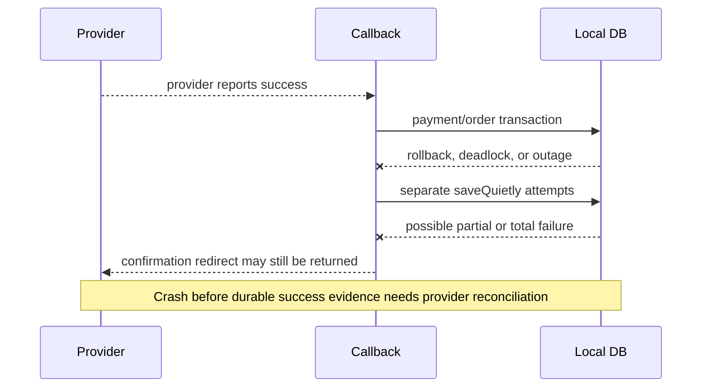
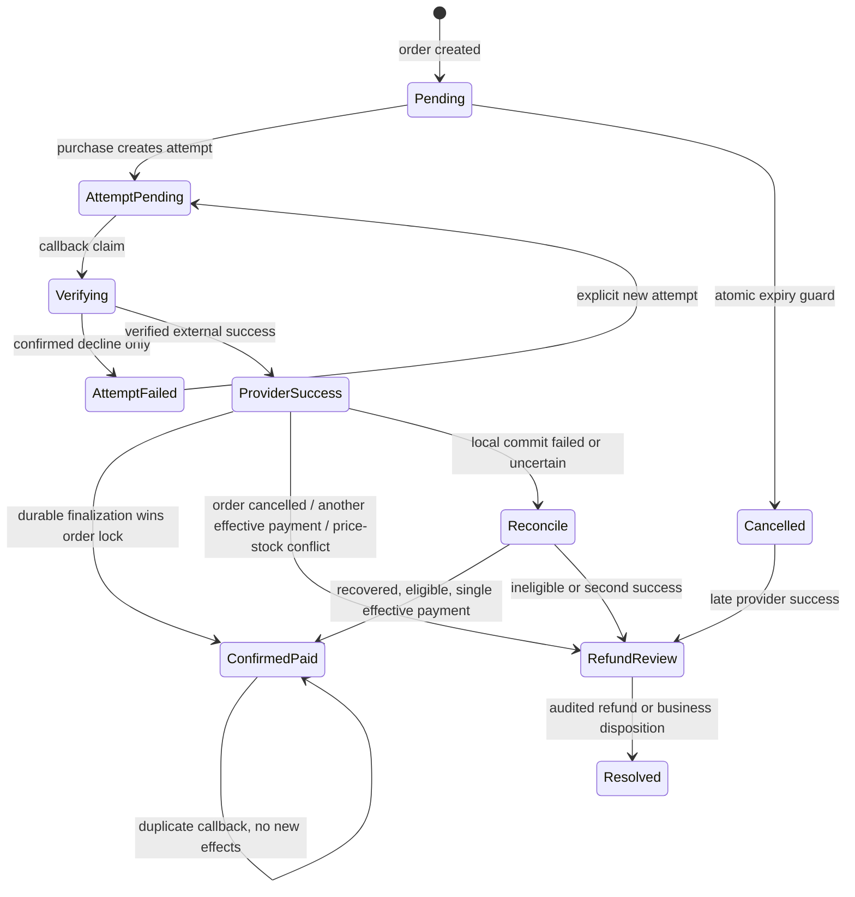

# ZIOTO — B2, B3, C1 payment lifecycle architecture

**Scope:** architecture and implementation planning only. **Evidence baseline:** backend `main` at `f84829a5ce9da2165b424e9637103e488c3106b5`, inspected 2026-11-12; frontend inspected for customer-facing contracts. No test, migration, provider call, or production database inspection was performed for this document. Prior financial-core, A1/B1 and E2E reports were read as context; code below is the authority for current behavior. Labels mean **CONFIRMED** = source-observed, **INFERRED** = consequence of source under stated ordering, **PROPOSED** = design, **UNVERIFIED** = requires operational or provider evidence.

## 1. Executive summary

**CONFIRMED:** A callback briefly locks a payment while moving `pending` to `processing`, then releases the lock before provider verification. Successful verification later writes payment and order through previously loaded models, without locking and rechecking the order. The unpaid-order scheduler selects candidates, then updates them without a fresh guarded check. A failed finalization transaction falls back to separate `saveQuietly()` writes and can redirect to confirmation even when those writes fail (`app/Http/Controllers/Api/PaymentController.php:331-356,399-413,517-605`; `app/Console/Commands/CancelUnpaidOrders.php:14-35`).

**INFERRED:** These boundaries permit duplicate verification and finalization, cancellation of an order being paid, and a provider-paid/local-unpaid discrepancy. Test outcomes on SQLite cannot establish row-lock behavior on the deployed database.

**PROPOSED:** Use one order-level serialization rule for finalization and cancellation; keep provider calls outside database locks; persist every verified external success and distinguish the **effective** order payment from additional successful payments; add durable reconciliation before relying on callback replay; move external side effects behind committed, idempotent work. Roll out in small gates, preserving `/api/payment/init`, public callback URLs, the five driver payloads, existing `payment_url` response, and current customer-facing status strings until a separately approved contract change.

## 2. Verified existing lifecycle

| Step | Source and observed behavior | Boundary / risk |
|---|---|---|
| Checkout/order | Main and Nopay call `api.orders.create` then `api.payment.init` (`frontend/src/app/pages/CheckoutPage.tsx:513-523`; `frontend/src/app/nopay/checkout/page.tsx:794-803`). `OrderSubmitController::submitOrder()` loads authenticated user's cart, checks stock and Nopay eligibility, optionally performs identity verification, then uses `DB::transaction(..., attempts: 3)` to reuse/create an order (`app/Http/Controllers/Api/OrderSubmitController.php:88-208,208-234,373-445`). | Identity service is outside this transaction. Reuse can update a pending order's amount and shipping without excluding an outstanding pending payment (`:548-627`); related B4 dependency, not a proposed B4 implementation. |
| Initiation | `POST /payment/init` has `auth.token`; callbacks remain public (`routes/api.php:124-129`). `init()` scopes order by authenticated user and platform, checks paid/cancelled, marks older pending attempts failed, calls Shetabit purchase, creates a pending `Payment` in its purchase callback, returns `payment_url` and `transaction_id` (`PaymentController.php:100-115,138-155,180-237`). | No encompassing order lock/transaction around purchase and attempt creation; provider purchase is external. |
| Provider return | Nopay has a bare return URL; `callbackByToken()` finds a pending/processing payment by `tv`/`Token`/`token`, then calls common callback (`PaymentController.php:180-184,263-287`; `app/Payment/Drivers/Nopay/Nopay.php:61-69`). Other route includes order ID and gateway. | Bare terminal-token replay redirects to main checkout; actual provider replay semantics are unverified. |
| Callback resolution | Common callback loads order without tenant scope, resolves token/uuid/tv against payment, order and platform; terminal resolved payment redirects to confirmation regardless of terminal outcome (`PaymentController.php:290-329`). Tokenless callback picks newest pending/processing payment by gateway and order (`:331-347`). | Gateway/path matching is not checked for resolved-token branch. No-token selection can be ambiguous among attempts. |
| Verify/failure | Short transaction locks payment and changes pending→processing, then commits. External verify uses current `order.total_amount`; Parsian nonzero callback status fails. Failure handlers refresh only the current payment, then update payment failed and order payment_status failed without order lock (`PaymentController.php:331-355,399-504`). | A timeout/exception may be indeterminate, not provider-declined. Failure of a different attempt can overwrite an already-paid order's aggregate payment status. |
| Success | After verify, stock is checked but insufficient stock only logs/adds note. A transaction updates payment paid, order paid/confirmed, note and cart deletion (`PaymentController.php:507-543`). | No fresh status or amount comparison under order lock. Transaction encloses observer work. |
| Recovery | On finalization exception, code logs, attempts independent quiet payment/order saves, discount redemption and cart delete; inner failure only logs; callback can still redirect to `/confirm` and queue SMS (`PaymentController.php:545-605`). | Partial local persistence and false success URL possible; `saveQuietly` suppresses order observers. |
| Cancellation | Every minute, with scheduler-overlap guard, command queries pending orders older than 20 minutes, payment pending/failed, no processing payment, then updates each to cancelled (`app/Console/Commands/CancelUnpaidOrders.php:14-35`; `routes/console.php:11-13`). | Candidate check and write are separate; scheduler overlap guard does not serialize with callback. |
| Customer state | Both confirm pages fetch `api.orders.show`; if `payment_status !== paid` or fetch fails, redirect to failure; successful fetch clears client cart (`frontend/src/app/pages/ConfirmPage.tsx:25-40`; `frontend/src/app/nopay/confirm/page.tsx:26-43`). API status exposes aggregate order status plus latest attempt (`PaymentController.php:608-625`; `frontend/src/lib/api-client.ts:272-278`). | A reconciliation state cannot simply masquerade as paid or failed; frontend UX/contract decision needed. |

## 3. Evidence and persistence map

| Artifact | Evidence | Implication |
|---|---|---|
| `orders` / `payments` | Original tables have independent string statuses and nullable relations (`Modules/Order/database/migrations/2026_06_15_000001_create_orders_table.php:11-22`; `Modules/Payment/database/migrations/2026_06_23_000001_create_payments_table.php:11-25`). Platform added to both (`database/migrations/2026_08_02_000001_add_platform_to_tenant_tables.php:23-48`). | No explicit effective-payment pointer, verification journal or reconciliation queue found in these schemas. |
| Uniqueness/indexes | Tenant migration replaces single-column keys with unique `(platform, transaction_id)` and `(platform, order_number)` (`database/migrations/2026_08_02_000002_make_tenant_uniques_composite.php:30-49`); payment indexes `(order_id,gateway,status)` and `(order_id,created_at)` (`database/migrations/2026_07_20_000001_add_performance_indexes.php:30-35`). Discount usage has unique `(discount_code_id,order_id)` (`database/migrations/2026_10_24_000001_create_discount_codes_tables.php:27-32`). | Transaction ID uniqueness is per platform, not per order/gateway, and does not prevent two paid attempts. Verify actual production migrations/indexes before designing online DDL. |
| Existing tests | `tests/Feature/Api/PaymentControllerCallbackTest.php`, `PaymentControllerInitTest.php`, `PaymentInitiationAuthorizationTest.php`, `OrderSubmitReuseTest.php`, `DiscountCodeReservationTest.php`, `tests/Unit/PaymentDriversTest.php`. | Baseline test fixtures are available; **UNVERIFIED** whether they cover real parallel connections, crashed workers or all provider replay behaviors. No tests were run here. |
| Database runtime | `config/database.php` defaults to `DB_CONNECTION=sqlite`; `.env.example` suggests MySQL. | **UNVERIFIED:** deployed engine, version, isolation level, replica topology and applied schema. Do not infer from local defaults. |

## 4. Confirmed vulnerabilities and risks

1. **CONFIRMED B2:** `processing` is accepted for another callback; payment lock is released before verify and finalization (`PaymentController.php:331-356,399-413,517-543`). **INFERRED:** two workers can both verify and execute effects. An Eloquent transaction makes each worker's writes atomic only if all invoked work stays transactional; it is not an exactly-once guard.
2. **CONFIRMED B2:** terminal `failed` resolves to `/confirm` on token path (`:317-319`); tokenless paid check uses tenant-scoped `Payment::where` despite public callback (`:369-385`). **INFERRED:** wrong customer destination and platform-dependent replay behavior.
3. **CONFIRMED B2:** failure handlers test only whether the same payment is paid (`:421-504`). **INFERRED:** a late failed attempt can make an order with another paid attempt appear failed.
4. **CONFIRMED B3:** scheduler candidate query and update have no shared order lock or conditional write with finalization (`CancelUnpaidOrders.php:17-35`). **INFERRED:** both cancelled→confirmed and confirmed→cancelled outcomes are possible from stale models.
5. **CONFIRMED C1:** after provider success, failed DB finalization can produce quiet partial writes and a confirmation redirect even after persistence fails (`PaymentController.php:545-605`). No durable local record guarantees recovery from a process crash between verify and commit.
6. **CONFIRMED cross-cutting:** `Smartis::verify()` calls `confirmPayment()` after status/amount check, before local commit (`app/Payment/Drivers/Smartis/Smartis.php:87-128,158-165`). **INFERRED:** that external confirmation cannot be rolled back by DB failure. Its endpoint response and repeatability need provider confirmation.
7. **CONFIRMED gateway-specific:** Digipay retries pending status in-process (`app/Payment/Drivers/CustomDigipay.php:64-109`); Kamanlend verifies `PaymentCompleted` (`app/Payment/Drivers/Kamanlend/Kamanlend.php:92-140`); Nopay requires approved entity (`app/Payment/Drivers/Nopay/Nopay.php:128-170`). **UNVERIFIED:** whether verification is read-only, one-shot, safely repeatable, or permits status polling for each gateway, including Parsian through the Shetabit package.

## 5. Critical race and failure timelines

```mermaid
sequenceDiagram
    participant A as Callback A
    participant B as Callback B
    participant DB as Local DB
    participant G as Provider
    A->>DB: lock payment; pending to processing; commit
    B->>DB: lock payment; sees processing; commit
    par external calls without DB lock
      A->>G: verify
    and
      B->>G: verify
    end
    A->>DB: update stale payment/order; observers
    B->>DB: update stale payment/order; observers
    Note over DB: Duplicate effects or terminal overwrite possible
```

```mermaid
sequenceDiagram
    participant S as Cancel scheduler
    participant C as Callback
    participant G as Provider
    participant DB as Local DB
    S->>DB: SELECT pending, no processing
    C->>DB: mark payment processing; commit
    S->>DB: UPDATE previously selected order to cancelled
    C->>G: verify success
    C->>DB: UPDATE order to confirmed, without fresh guard
    Note over S,DB: Reverse order can cancel an already confirmed order
```



## 6. Proposed invariants

**PROPOSED:** (I1) Every provider-confirmed monetary success is recorded or placed in a discoverable reconciliation exception; never silently discard a second charge. (I2) At most one payment is the **effective fulfillment payment** for an order; additional successful attempts remain financial facts requiring refund/offset review. (I3) Confirming, cancelling, expiring and marking aggregate payment failure must serialize on the same order row and re-evaluate current DB state. (I4) `paid` never regresses to failed/pending through a later attempt; payment attempt terminal outcomes are immutable except audited correction. (I5) Reserve stock, redeem discount, emit financial confirmation, create invoice, send each SMS and clear cart at most once per business key, or flag an exception where external exactly-once cannot be guaranteed. (I6) Customer “paid/confirmed” is displayed only after durable local commit; indeterminate provider outcomes are not labelled declined. (I7) Provider verify/confirm requests run without long-held DB row locks. (I8) Every transition identifies platform, order, gateway, attempt and immutable amount snapshot; check callback gateway against resolved payment.

## 7. Proposed state machine

**CONFIRMED existing public values:** order `pending`, `confirmed`, `cancelled`, `expired` and payment_status `pending`, `failed`, `paid` appear in the reviewed paths; attempt `pending`, `processing`, `failed`, `paid`. Other order states may exist elsewhere; do not replace the current enums/strings wholesale.

**PROPOSED:** Keep public statuses. Use an internal verification/exception record with `unresolved`, `provider_success`, `locally_committed`, `reconciliation_required`, `refund_required`, `resolved` as separately named lifecycle values only after schema review. A temporary `processing` attempt needs a lease/claim expiry and a reconciler; elapsed time alone must not mean provider failure.



**Forbidden:** cancelled→confirmed automatically; paid→failed from any later callback; failed→paid without fresh provider evidence; customer confirmation based solely on redirect; deleting/rewriting a second successful charge. Cancellation may win only when no unresolved/processing provider attempt under the agreed policy. A callback that loses the order lock must read committed state and choose duplicate, conflict or late-payment handling.

## 8. Database constraints and persistence

| Proposed persistence | Why / uniqueness and locking | Migration, backfill and rollback |
|---|---|---|
| First gate: no schema change | Lock `orders.id` first, then `payments.id` in all callback, cancellation and aggregate failure paths; conditionally update from expected state and reread. Avoid `lockForUpdate()` through a missing row. | Application-only deployment; rollback code is possible, but already persisted conflict outcomes require review. Real MySQL/PostgreSQL concurrency tests required. |
| Durable verification journal/inbox | Store `platform, gateway, payment_id, order_id, provider transaction ID/reference, amount, evidence digest/redacted receipt, observed_at, outcome, reconciliation state`. Unique **attempt + evidence identity**, with explicit decision for providers whose reference is blank or changes. A verified second payment needs its own row. | Additive table/index after duplicate audit; backfill only confirmed historical successes with source provenance, mark uncertain as unknown. Do not infer provider success from `order.payment_status` alone. Rollback must preserve ledger data even if code is reverted. |
| Effective-payment marker | Prefer unique `orders.effective_payment_id` plus FK/consistency checks or a separate one-row-per-order decision table, set under order lock. Never use a unique paid-payment-per-order index: it would reject recording a real second charge. | Add nullable column/table, backfill from unambiguous paid attempts, exception-queue ambiguous orders. Check FK/tenant consistency in application and DB where feasible. Reversal requires ledger-preserving compatibility code. |
| Durable outbox and exception queue | Unique `(event_type, business_key)` for invoice/stock/discount/SMS intents; lease, attempts, last error, timestamps, operator audit for reconciliation. Commit intent with order transition. | Additive tables and worker rollout; drain/disable worker before rollback, retain pending events for replay. Avoid putting secrets or unredacted provider payloads in logs/events. |

**CONFIRMED:** Existing `(platform, transaction_id)` unique prevents identical IDs within a platform, even soft-deleted rows if the index remains physical, but it does not identify an effective payment (`database/migrations/2026_08_02_000002_make_tenant_uniques_composite.php:41-49`). **PROPOSED:** index callback lookups by platform/gateway/transaction ID as required by actual query plan; cancellation scan by status/payment_status/created_at, and exception/outbox due-work indexes. Validate existing data and online DDL cost before any migration.

**UNVERIFIED database:** MySQL/InnoDB and PostgreSQL both support row locks, but lock timing, isolation defaults, deadlock behavior, DDL and filtered unique indexes differ. PostgreSQL partial unique indexes can express conditional uniqueness; MySQL usually needs generated-column or separate-table design for equivalent condition. Avoid a conditional unique “paid payment” index for the financial reason above. SQLite's `lockForUpdate()`/single-writer behavior is not a production-concurrency proof. Confirm deployed engine/version/isolation, scheduler instances and transaction retry policy before code design is finalized.

## 9. Observer and external side-effect map

| Effect | Current trigger/location | Safe placement and key |
|---|---|---|
| Discount | `DiscountCodeUsageObserver::updated` redeems on paid and releases on cancelled/expired (`app/Observers/DiscountCodeUsageObserver.php:12-28`); `DiscountCodeService` updates `reserved` **or `released`** to redeemed and only reserved to released (`app/Services/DiscountCodeService.php:61-90`). | Keep atomic DB discount transition with order decision. Unique usage already exists; guard one transition/order. Late payment after released discount requires explicit policy and availability check. |
| Product reserved stock | Observer on order status transition; gated by `hesabfa.enable_reserved_stock`, conditional product increment, but insufficient stock logs and still confirms (`app/Observers/StockReservationObserver.php:29-43,56-93,96-119`). | DB reservation can be in same order transaction if invariant/lock order is established. Record reservation business key and result; do not promise stock from a status flag. Stock sufficiency behavior is B5 policy, not silently changed here. |
| Hesabfa contact/invoice | Order observer registered first (`app/Providers/AppServiceProvider.php:84-87`), syncs when status reaches configured states; `syncOrder()` starts a nested DB transaction and makes synchronous external contact/invoice calls before local commit (`app/Observers/HesabfaObserver.php:21-119`). | Decouple from payment transaction; durable post-commit intent keyed by order and invoice type. Provider-side idempotency/search-before-retry must be verified. Local DB rollback cannot undo a created external invoice. |
| SMS | Order observer queues received-health message (`app/Observers/OrderSmsNotificationObserver.php:12-17`); callback separately queues confirmation and received-health after finalization (`PaymentController.php:601-603`). Job uses `ShouldBeUnique`, `afterCommit`, sent markers and retries (`app/Jobs/SendOrderSms.php:13-40`; `app/Services/OrderSmsNotificationService.php:33-110`). | Retain after-commit dispatch, but use durable event key per order/type for delivery intent. Cache uniqueness and markers mitigate duplication; send-success/marker-failure remains an external ambiguity. |
| Cart and notes | Cart deletion and success note within finalization transaction; fallback repeats cart deletion and quiet saves (`PaymentController.php:517-576`). Frontend confirm pages clear local carts after paid order fetch. | Cart delete is local/idempotent but must occur only for effective success; note should have unique transition/event key. Do not clear client cart on reconciliation or false confirmation. |

## 10. Strategy comparison

| Strategy | Correctness/recovery | Complexity and migrations | Gateway/contract impact | Deployment risk |
|---|---|---|---|---|
| **A — targeted locks/CAS** | Prevents common duplicate finalization and cancellation races; still cannot recover crash after provider success if no durable evidence. | Low; potentially no schema. Real DB concurrency tests mandatory. | No driver payload or frontend contract change. | Lowest change surface, insufficient C1 completion. |
| **B — shared finalization coordinator** | One state-transition implementation for callback, failure and scheduler; makes effect ordering testable. Without durable journal, provider/local gap remains. | Medium; can start without schema, then add effective marker. Observer integration is sensitive. | Callback URL and success JSON preserved; late-payment response needs policy. | Medium; watch old observer re-entry. |
| **C — journal, reconciler, outbox** | Strongest recoverability and independent side-effect retry; provider guarantees remain limiting. | High; additive migrations, worker, operations, historical backfill. | Five-gateway status/reverify capabilities must be confirmed; public APIs can stay stable with internal states. | Highest; staged shadow and reconciliation required. |

**PROPOSED recommendation:** A+B first for order-level atomicity and shared decision logic, then C for verified-success durability and exception handling. Do not declare C complete until callback omission and crash recovery can be demonstrated per gateway. Keep external verify outside locks; use a short claim lease and final transaction recheck. A claim without expiry/recovery can strand payments forever.

## 11. Recommended staged architecture

**PROPOSED transaction protocol:** (1) Resolve platform/order/gateway/attempt; reject mismatch, preserve public callback accessibility. (2) Claim attempt atomically with bounded lease and correlation ID; do not turn ambiguous timeout into failed. (3) Verify with provider outside DB locks, using attempt amount snapshot; record redacted evidence if storage available. (4) In a short transaction lock order then attempt in consistent order, re-read statuses and amount; decide effective success, duplicate, cancelled/expired conflict, or second paid exception. Persist payment outcome, order status, local discount/stock decision, journal and outbox atomically. (5) After commit, dispatch outbox work. (6) On DB failure, do **not** run piecemeal quiet saves or claim confirmed; create/retain durable reconciliation evidence if storage is available, alert operator, and query provider later using documented status capability. If DB is wholly unavailable, local durability cannot be guaranteed: external provider report/status export and transaction correlation are the recovery source. (7) If response is lost after commit, replay reads the committed decision and returns the same customer outcome without side effects.

**C1 limitation:** An inbox written before verify records that verification was attempted, not that the provider succeeded. A crash after provider success but before evidence commit remains a gap; only provider-side idempotent status inquiry, settlement feed, or manual merchant reconciliation closes it. A queue dispatch without durable DB record does not.

## 12. Regression and failure-injection matrix

All tests: isolated staging-equivalent relational DB, separate processes/connections for races, frozen clock where needed, mocked gateway/SMS/Hesabfa/bank; capture SQL state, outbox/exception rows, provider mock call counts and customer redirect. No live provider calls. `P` = pending order/attempt; `V` = externally verified success; `F` = confirmed provider decline; `E` = exception/reconciliation record.

| Scenario; initial → trigger | Expected final state | Forbidden outcome | Expected effects / evidence required |
|---|---|---|---|
| Sequential duplicate; P→V then same callback | One effective paid/confirmed; same result on replay | Second confirmation/side effects | One reservation, redemption, invoice intent, SMS intent; journal/idempotency key and provider call count. |
| Parallel identical callbacks; P→two workers, barrier at claim/finalize | Same as above; one decision winner | Two effective successes, deadlock left unresolved | Two DB connections, deterministic barrier, one transition/outbox key, lock trace. |
| Two attempts both externally succeed; P→V(A), V(B) | A effective, B recorded `refund_required`/review | Dropped B, second fulfillment | Two external facts, one order confirmation; provider references and exception queue. |
| Success then failed old attempt; paid A→F(B) | Order stays paid; B failed only | Aggregate paid→failed | No new fulfillment; status snapshot and event counts. |
| Cancel reads, callback claims; P→scheduler/callback barrier | Scheduler rechecks under order lock; if verify unresolved, defer per approved policy | Cancelled while in protected in-flight window | Lock/row state trace, no premature release. |
| Cancel wins, late V; P→cancel then V | Cancelled + provider success recorded, refund/review pending | Auto-confirm at stale metal price; silent discard | No invoice/SMS fulfillment; exception evidence and customer-safe outcome. |
| Verify delayed past 20 min; P→slow provider, scheduler | Processing lease/policy prevents premature final cancellation or creates review | Conflating slow verify with decline | Clock/lease evidence, deterministic scheduler race. |
| V then DB exception before commit; P→V, fail write | Reconciliation-required; no customer paid claim until durable commit | Quiet partial save or false confirm | Inject fail at each write; provider receipt, alert and eventual recovery evidence. |
| V then deadlock; P→V, deadlock once | Bounded local transaction retry; one committed decision | Repeating irreversible provider verify blindly | Deadlock injection, retry count, one outbox row. |
| Payment write succeeds, order write/observer fails; P→V | Transaction rollback or explicit durable exception; recovered consistently | Payment paid/order pending indefinitely without alert | Fault at each observer, DB snapshot and exception trace. |
| Queue/SMS failure after commit; paid→dispatch/send fail | Paid remains; durable intent retries; SMS marker reconciled | Duplicate SMS or rollback of payment | Mock failures, outbox attempts, provider send count. |
| Hesabfa timeout after external invoice acceptance; paid→timeout | Invoice intent uncertain, reconcile by business key | Automatic duplicate invoice | Mock accepted-then-timeout, lookup/replay evidence. |
| Provider replay changes response; P→V then replay F/unknown | Persisted V remains authoritative; mismatch flagged | Paid→failed | Stored receipt digest, replay discrepancy alert. |
| Callback omitted; P→provider V without callback | Reconciler discovers V from supported status/settlement or manual queue | Invisible paid funds | Provider mock poll/export, age threshold and exception row. |
| Provider timeout after successful transaction; P→ambiguous verify | Unresolved pending reconciliation, no decline claim | Retry purchase/second charge without evidence | Timeout mock followed by provider status, correlation ID. |
| Crash between V and commit; P→kill worker | Recovery from pre-verify intent + provider status/settlement | Claim of guaranteed local evidence | Process kill and restarted worker, one final decision. |
| Reconciliation replay; E→retry twice | Single effective decision or refund review | Duplicate stock/invoice/SMS | Journal version, outbox uniqueness, provider mock counts. |
| Price/stock/discount conflict; cancelled/expired→late V | Review/refund, no auto-fulfillment | Old-price confirmation or unavailable stock reservation | Frozen price, released discount/stock snapshots, operator decision trail. |
| Gateway matrix; each of Parsian, Digipay, Kamanlend, Smartis, Nopay P→V/F/replay | Same public URL contract and correct per-driver evidence | Changed payload/callback, live call | Mock driver requests/responses; explicit Smartis confirm and Nopay bare callback cases. |

## 13. Deployment and rollback considerations

**PROPOSED:** Baseline deployed DB metadata, duplicate paid attempts, cancelled-but-paid orders, pending/processing age, provider reference coverage, observer configuration, queue transport and scheduler topology before rollout. Stage additive schema with online DDL assessment; deploy code able to read old/new rows before enabling writes or workers. Replay anonymized production-like race fixtures on the same engine/isolation. In staging, use merchant sandboxes only if approved and separated; default to mocks. Monitor provider-success/local-commit gaps, multiple successes/order, cancellation conflicts, expired processing leases, reconciliation lag, outbox backlog, Hesabfa invoice duplication, SMS retry counts and callback latency by gateway/platform. Alert a named financial operator with an auditable queue.

Rollback is **code/feature-flag rollback, not deletion of financial evidence**. Disable new worker/claim path, preserve journal/outbox/exception tables, drain or quarantine queued events, and reconcile provider payments before restoring old callback behavior. A rolled-back old binary may not understand new statuses; therefore keep public statuses stable and test backward-compatible reads. Do not automatically reverse a committed paid order, payment or external provider confirmation. No migration or deployment occurs in this task.

## 14. Decisions requiring business approval

1. Late verified payment after 20-minute cancellation/metal-price expiry: refund, manual repricing and customer re-consent, or another disposition; never auto-restore by default.
2. Second externally successful attempt: refund priority/SLA, fee ownership, customer notification, accounting treatment and dispute handling.
3. Whether an unresolved provider verification blocks cancellation, and for how long; what happens when a lease expires.
4. Whether stock/discount can be reallocated after cancellation, and what to do if unavailable when late payment is found.
5. Customer-facing state for verified-but-not-committed, refund-required and reconciliation-required cases, including Nopay and main confirmation/failure pages.
6. Whether failure/timeout permits a new purchase attempt before provider status is reconciled; operator authority and audit requirements for manual overrides.

## 15. Unknowns and external dependencies

**UNVERIFIED:** production DB engine/version/isolation/applied indexes; multiple application/scheduler nodes; queue `afterCommit` transport and cache uniqueness reliability; real provider callback retry/ordering/signature guarantees; re-verification and status-query limits for Parsian, Digipay, Kamanlend, Smartis, Nopay; Smartis confirmation idempotency; settlement export/reference semantics; provider refund API/policy; actual Hesabfa invoice idempotency; production deployment of frontend main/Nopay versions. Source confirms method calls, not external guarantees. Obtain provider contracts and operational metadata without live transactions before implementing C1 automation.

## 16. Exact implementation roadmap and acceptance gates

| Phase | Files/modules to change later; migration | Acceptance gate / compatibility / monitor and rollback |
|---|---|---|
| 0. Baseline | Documentation plus new tests beside `tests/Feature/Api/PaymentControllerCallbackTest.php`, `PaymentControllerInitTest.php`, command tests for `CancelUnpaidOrders`; no application change. | Capture current behavior and DB engine; deterministic two-connection races, gateway mocks, no live integrations. Gate: reviewed invariants/business policy. |
| 1. Idempotent callback | `app/Http/Controllers/Api/PaymentController.php`; preferably new `app/Services/PaymentFinalizationService.php`; callback tests. No initial migration. | Order-first locking/CAS, token/gateway match, terminal replay correctness, failure cannot overwrite paid. Keep URLs/JSON. Gate: all five gateway fixtures and real-DB parallel tests; monitor duplicate decisions. Roll back code if regression; review any external success. |
| 2. Cancellation conflict | `app/Console/Commands/CancelUnpaidOrders.php`, shared finalization service, command/race tests; no initial migration if claim policy can be safely represented. | Same order lock/guard, deterministic race in both orders, no cancelled→confirmed auto-transition. Gate: approved processing lease/expiry rule and alerting. Monitor deferred cancels; rollback command via scheduler disable only with manual backlog handling. |
| 3. Durable recovery | New additive migration/model/service for verification journal, effective decision and financial exceptions; payment callback and reconciliation command/job plus tests. | Provider reference capability and historical data audit completed; crash/DB outage/callback omission tests pass per gateway. Monitor gap and queue age. Preserve journal on rollback. |
| 4. Side-effect isolation | `app/Observers/HesabfaObserver.php`, `StockReservationObserver.php`, `DiscountCodeUsageObserver.php`, `OrderSmsNotificationObserver.php`; `app/Services/OrderSmsNotificationService.php`; `app/Jobs/SendOrderSms.php`; outbox migration/worker if justified. | External calls out of payment transaction, stable business keys, fault-injection for invoice/SMS/stock/discount/cart. Monitor outbox and duplicates. Rollback only after draining/quarantining intents. |
| 5. Controlled rollout | Configured feature flags, staging deployment playbook and operational dashboards; frontend `ConfirmPage.tsx` and `nopay/confirm/page.tsx` only after UX decision. | Staging-equivalent DB and mocks, approved business policy, shadow comparison, canary by platform/gateway if safe, operator staffing, reconciliation dry run. No production GO solely from tests. |

Do not start a later phase until the preceding gate is met; preserve A1/B1 controls and exclude unrelated pricing, B4/B5 and gateway refactors.

## 17. Final readiness assessment

**CONDITIONAL GO for implementation planning; NO-GO for production rollout now.** Source evidence is sufficient to design and begin isolated baseline/race tests, then a tightly scoped A+B implementation after policy and DB metadata confirmation. C1 recovery cannot be certified until durable evidence, provider inquiry/settlement capabilities, failure-injection and an operator reconciliation process exist. This document provides no evidence of zero side effects or production safety.
