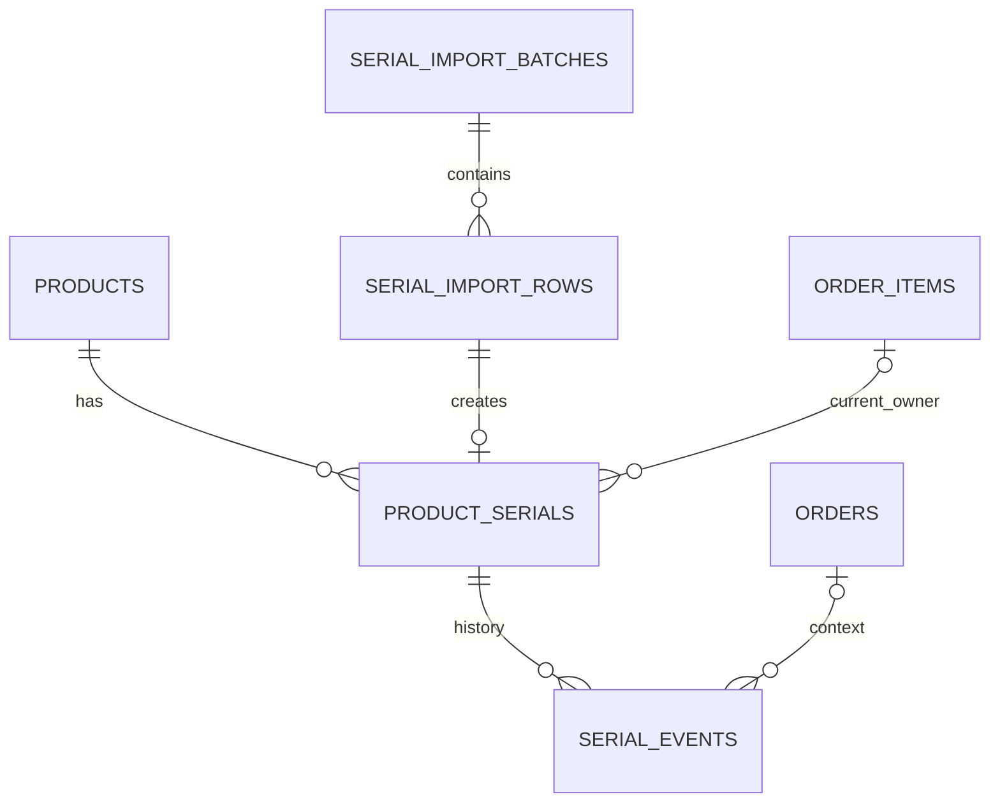

# پلن اجرایی ایمپورت سریال و انبارداری سریال‌محور

> وضعیت: پلن اصلاح‌شده پس از بازبینی مشترک؛ پیاده‌سازی انجام نشده است.
> تاریخ: ۲۰۲۶-۱۰-۱۱ — مخاطب: تیم بک‌اند و مدیر انبار
> هنگام اجرا، مراحل با تست شکست‌خورده شروع و پس از پیاده‌سازی، آزمون و بازبینی تکمیل شوند. اجرای موازی فقط با هماهنگی مسئول اجرا انجام شود.

**هدف:** افزودن ایمپورت اکسل به پنل Filament، تبدیل سریال‌های آزاد به مرجع موجودی فروش آنلاین و تخصیص یک سریال به هر واحد از آیتم‌های سفارش پرداخت‌شده.

**معماری:** هر محصول یکی از دو روش موجودی «سریالی» یا «دستی / تولید پس از سفارش» دارد. نگاشت پیشوند در دیتابیس است؛ رهگیری سریال هنگام تحویل مستقل از روش موجودی است. قبل از درگاه، سریال آماده یا ظرفیت دستی رزرو و پس از پرداخت نهایی می‌شود. تاریخچه و گزارش ایمپورت ماندگارند. موجودی از حسابفا دریافت نمی‌شود و تپسی فقط قیمت می‌گیرد.

**نسخه‌های بررسی‌شده:** PHP 8.5.0، Laravel 13.35.0، Filament 5.10.0، PhpSpreadsheet 5.10.0، PHPUnit 12.5.38. اتصال فعلی MySQL و جداول بررسی‌شده InnoDB هستند؛ صف پیش‌فرض database است. نسخه سرور MySQL قبل از آزمون همزمانی و استفاده از امکانات اختصاصی بررسی شود.

## ۱. محدوده و تصمیم‌های مبنا

- فقط ستون **M** با عنوان **عامل اول** پردازش می‌شود؛ سطر اول عنوان و شروع داده سطر دوم است. ستون‌های دیگر در انتخاب محصول، تعداد یا موجودی نقشی ندارند.
- پیشوندها بدون حساسیت به بزرگی و کوچکی حروف مقایسه می‌شوند. نگاشت هاردکد توصیه نمی‌شود.
- main و nopay از موجودی سریال مشترک استفاده می‌کنند؛ tapsi از رزرو، تخصیص و کنترل موجودی سریالی مستثنی است، مطابق تصمیم ثبت‌شده در پلن قبلی.
- دریافت موجودی از حسابفا برای تمام محصولات متوقف شود: فرمان و زمان‌بندی سینک موجودی، مسیر دستی دریافت موجودی و اعمال موجودی از وب‌هوک. ستون‌های قدیمی فقط سابقه‌اند و در تصمیم خرید خوانده نمی‌شوند. سینک فاکتور موضوع مستقل است و حذف نمی‌شود.
- تپسی فقط قیمت محصول دریافت کند؛ فیلد stock/quantity/availability از تمام payloadهای ارسال قیمت حذف شود. ارسال عدد صفر هم مجاز نیست. استثنای مصرف نکردن موجودی سایت توسط سفارش تپسی برقرار است.
- برای هر محصول inventory_mode تعیین شود: serial یا manual. حالت manual برای موجودی دستی و پذیرش تولید پس از سفارش است؛ هیچ fallback خودکار از serial به manual وجود ندارد.
- محصول سریالی با صفر سریال available ناموجود است، حتی اگر stock_quantity یا موجودی حسابفا مثبت باشد.
- سریال موجود با هر وضعیت و سابقه‌ای هنگام ایمپورت دوباره تغییر محصول یا وضعیت نمی‌دهد.
- پکیج جدید لازم نیست. نسخه اول فقط XLSX را می‌پذیرد؛ پشتیبانی XLS/CSV و تغییر ستون دلخواه به آن اضافه نمی‌شود.

## ۲. اکسل نمونه و نگاشت پیشوندها

### ۲.۱. نتیجه بررسی مستقیم فایل

| مورد | نتیجه |
| --- | --- |
| شیت | `1` |
| محدوده اعلام‌شده | `A1:N101` |
| عنوان M1 | `عامل اول` |
| داده غیرخالی | ۳۰ مقدار متنی در M2 تا M31 |
| یکتایی | ۳۰ سریال یکتا؛ بدون تکرار داخلی |
| پیشوند واقعی | `stn` |
| نمونه اول و آخر | `stn90505511` و `stn90505549` |
| فرمول در M | مشاهده نشد |
| ردیف انتهایی خالی | ۷۰ ردیف از ۳۲ تا ۱۰۱ |

کاربر اعلام کرد پیشوند برند دیگر جزو محصولات سایت نیست و فایل صرفاً نمونه است. در پیام از `sdn` نام برده شده، در فایل واقعی `stn` وجود دارد. **هیچ‌کدام به‌صورت فرضی به محصول سایت نگاشت یا seed نمی‌شوند.** فایل نمونه آزمون قالب و گزارش پیشوند ناشناخته است: انتظار فعلی **صفر سریال جدید و ۳۰ ردیف unknown_prefix**. آزمون ورود موفق از fixture جدا با پیشوند معتبر سایت استفاده می‌کند.

گپ شماره کارخانه خطا نیست؛ سریال‌های بین دو شماره تولید نشوند. بخش عددی رشته است و صفر ابتدایی حفظ می‌شود.

### ۲.۲. جدول تصویر تأییدشده

تصویر ۳۶ پیشوند غیرخالی دارد. جدول زیر lowercase است؛ وزن‌ها برای تطبیق با محصول واقعی‌اند و مجوز ساخت یا تغییر محصول نیستند.

| خانواده | وزن/مدل تصویر | پیشوند |
| --- | --- | --- |
| طلا زیوتو | 0.5 | `tha` |
| طلا زیوتو | 1 | `ton` |
| طلا زیوتو | 2.5 | `ttw` |
| طلا زیوتو | 5 | `tfv` |
| طلا زیوتو | 10 | `tte` |
| طلا زیوتو | 20 | `ttn` |
| طلا زیوتو | 31.1 | `tou` |
| طلا زیوتو | 50 | `tft` |
| طلا زیوتو | 100 | `thd` |
| طلا زیوتو | 250 | `tff` |
| طلا زیوتو | 500 | `tfh` |
| طلا زیوتو | 1000 | خالی؛ بدون نگاشت |
| طلا زیوتو پلاس | 1 | `ton9` |
| طلا زیوتو پلاس | 5 | `tfv9` |
| طلا زیوتو پلاس | 10 | `tte9` |
| نقره زیوتو | 0.5 | `zpf` |
| نقره زیوتو | 1 | `zon` |
| نقره زیوتو | 2.5 | `ztp` |
| نقره زیوتو | 5 | `zfi` |
| نقره زیوتو | 10 | `zte` |
| نقره زیوتو | 15 | `zff` |
| نقره زیوتو | 31.1 | `zou` |
| نقره زیوتو | 50 | `zft` |
| نقره زیوتو | 100 | `zhd` |
| نقره زیوتو | 250 | `ztf` |
| نقره زیوتو | 500 | `zfh` |
| نقره زیوتو | 1000 | `zth` |
| نقره زیوتو | 3110 | `zoz` |
| پلاکو | 100 | `gpo` |
| پلاکو | 200 | `gpt` |
| پلاکو | 300 | `gph` |
| پلاکو | 400 | `gpf` |
| پلاکو | 500 | `gpi` |
| پلاکو | 1 | `gpn` |
| پلاکو | 2.5 | `gpw` |
| پلاکو | 5 | `gpv` |
| پلاکو | 10 | `gpe` |

### ۲.۳. قرارداد تشخیص محصول

1. lowercase و trim ابتدا/انتها؛ ارقام فارسی/عربی به ASCII تبدیل شوند، مقدار اولیه در گزارش بماند.
2. فاصله داخلی، نیم‌فاصله و نویسه نامرئی داخلی، فرمول و عدد خالص رد شوند. حذف خودکار این نویسه‌ها ممکن است شناسه خراب را معتبر جلوه دهد.
3. regex عمومی `\A[a-z]{3}9?[0-9]+\z` و حداکثر طول کل ۵۰ کاراکتر؛ محدودیت تعداد ارقام از فایل نمونه استنتاج نشود.
4. نگاشت تمام محصولات دارای پیشوند، شامل محصولات غیرفعال در رهگیری، یک‌بار در هر تحلیل بارگذاری و با طول نزولی مرتب شود؛ هر ردیف query جدا نزند.
5. بلندترین پیشوند شناخته‌شده انتخاب و باقی‌مانده عددی و غیرخالی بررسی شود. اگر track_serials=false است، نتیجه product_not_tracked است؛ fallback به پیشوند کوتاه‌تر ممنوع. محصول manual با track_serials=true می‌تواند سریال تولیدشده را وارد کند؛ این ورود ظرفیت فروش دستی را افزایش نمی‌دهد.
6. ناشناخته نتیجه unknown_prefix دارد؛ مشابهت پیشوند صرفاً راهنمای اپراتور است، نه انتخاب خودکار محصول.

طبق قرارداد پذیرفته‌شده اولویت پیشوند بلندتر، `ton90505511` به `ton9` یعنی پلاس تعلق دارد؛ توضیح اولیه مثال اصلاح شده است. این قرارداد فرض می‌کند کارخانه سریال عادی ton را در فضای شماره‌ای رزروشده برای ton9 صادر نمی‌کند؛ الگوریتم دو شناسه کاملاً یکسان با معانی متفاوت را تفکیک نمی‌کند. تست‌ها: `TON90505511` برای پلاس و `ton70505511` برای معمولی؛ همین سناریو برای tfv/tfv9 و tte/tte9.

## ۳. یافته‌های کدبیس و نقاط تغییر

| مسیر موجود | رفتار فعلی | تغییر لازم |
| --- | --- | --- |
| `Modules/Product/app/Models/Product.php` | sellable_stock از حسابفا/رزرو عددی | انتخاب موجودی serial/manual؛ حذف وابستگی محاسبه به حسابفا |
| `Modules/Order/app/Models/OrderItem.php` | هر آیتم quantity دارد | یک سریال برای هر واحد |
| `OrderSubmitController::store/validateCartStock` | select محصول محدود؛ کنترل وابسته به تنظیم حسابفا | افزودن track_serials و count؛ کنترل سریال مستقل در main/nopay |
| `PaymentController::init/validateOrderStock` | کنترل عددی قبل از درگاه بدون رزرو سریال | بررسی و رزرو اتمیک قبل از purchase؛ احتساب رزرو خود سفارش |
| `PaymentController::callback` | کمبود موجودی مانع confirmed نیست؛ fallback با saveQuietly | ثبت حقیقت پرداخت و نهایی‌سازی قابل بازیابی؛ عدم اتکا به observer |
| `ProductResource`, `CartResource`, `RigeProductResource` | stock از stock_quantity | main/nopay بر اساس inventory_mode؛ stock_quantity فقط در حالت manual |
| `ProductController`, `RigeController` | پاسخ محصول ۶۰ ثانیه cache | موجودی زنده جدا از cache کاتالوگ، count گروهی روی primary |
| `CartController` | رابطه محصول با select محدود | افزودن پرچم و count لازم |
| `SiteWarehouse` | موجودی عددی قابل ویرایش، فقط dynamic و مجوز حسابفا | همه محصولات سریالی، موجودی خواندنی و مجوز مستقل |
| `ProductForm`, `ProductsTable`, `ManageProductPricing` | مدیریت موجودی legacy | کنترل پیشوند و منع ویرایش عددی موجودی سریالی |
| `TokenikoDirectSyncService` و دیگر ارسال‌کنندگان تپسی | قیمت همراه موجودی ارسال می‌شود | payload فقط قیمت؛ حذف فیلد موجودی حتی در حالت emergency |
| `StockReservationObserver`, `RecalculateReservedStock` | رزرو عددی حسابفا | جایگزینی با رزرو serial/manual سایت؛ رزرو حسابفایی از مسیر فعال خارج شود |
| `StockSyncService`, `SyncHesabfaStock`, `HesabfaWebhookController`, `AppServiceProvider` | سینک موجودی دوره‌ای/دستی/وب‌هوک | توقف دریافت و اعمال موجودی برای همه محصولات، حفظ مسیرهای مستقل فاکتور |
| `HesabfaObserver` | ممکن است درخواست شبکه داخل transaction سفارش بفرستد | اثر جانبی خودکار پس از commit؛ حفظ سینک فاکتور |
| `CancelUnpaidOrders` | لغو unpaid قدیمی؛ کنار گذاشتن processing | هماهنگی با رزرو و پرداخت مبهم، scope صریح همه platformها |

محصولات مشترک‌اند ولی Order و Payment tenant scope دارند. job سفارش را با id و platform معتبر صریح بارگذاری کند؛ header پیش‌فرض worker نباید nopay را مخفی کند. احراز مالکیت API حفظ شود. مقدارهای چند آیتم با product_id مشترک پیش از بررسی موجودی جمع شوند.

## ۴. طراحی داده و قیود

### ۴.۱. محصولات

- `products.serial_prefix`: nullable، رشته ۴ کاراکتر و unique؛ lowercase قبل از ذخیره. نام coding_prefix هم ممکن است، اما در این طرح نام واحد serial_prefix انتخاب شده است.
- `products.inventory_mode`: enum برنامه با مقادیر serial/manual؛ ستون رشته‌ای، حالت اولیه manual و انتخاب serial فقط پس از تطبیق فیزیکی و نگاشت معتبر. این فیلد مرجع تصمیم موجودی است.
- `products.track_serials`: boolean برای الزام رهگیری سریال تحویل؛ مستقل از inventory_mode. حالت serial الزاماً true دارد. در manual می‌تواند true باشد تا محصول بعد از تولید سریال بگیرد، بدون اینکه خرید نیازمند سریال آماده باشد.
- stock_quantity در manual تعداد واحدهای قابل پذیرشِ پرداخت‌نشده است، نه الزاماً کالای آماده. برای شمش یک کیلو می‌توان مثلاً ظرفیت ۲ سفارش تعیین کرد. پس از پرداخت موفق ظرفیت کم می‌شود؛ صفر یعنی عدم پذیرش سفارش تازه.
- «تولید پس از سفارش» یک تنظیم نمایشی/تأمین مستقل از manual بودن موجودی است؛ محصول دستی ممکن است کالای آماده هم باشد. فیلدهای products.made_to_order (boolean پیش‌فرض false) و production_lead_time_text (nullable) و snapshot آن‌ها روی آیتم، مشخص کنند چه زمانی awaiting_production و توضیح زمان تولید لازم است. برای شمش یک‌کیلو نمونه، manual + made_to_order=true + track_serials=true پیشنهاد می‌شود؛ انتخاب واقعی از پنل انجام شود.
- پیشوند با regex `\A[a-z]{3}9?\z`؛ فرم محصول برای تنظیم آن product.edit و مجوز serial.manage بخواهد.
- با وجود سریال، تغییر/انتقال پیشوند و خاموش کردن رهگیری از فرم عادی ممنوع. تغییر inventory_mode نیز با رزرو/سفارش باز ممنوع؛ هنگام تغییر بدون عملیات باز، ظرفیت/موجودی تطبیق و علت ممیزی ثبت شود. کمبود سریال خودکار محصول را manual نکند.
- فعال‌سازی پس از آماده شدن موجودی واقعی؛ صفر سریال به معنی ناموجود، نه fallback.
- seed از روی وزن یا کد ستون H محصول را حدس نزند؛ فقط SKU/product_id تأییدشده اپراتور نگاشت شود.

### ۴.۲. serial_import_batches

فیلدها: id، original_filename، file_path، file_hash با طول ۶۴ و index غیرunique، worksheet_name، column_letter=M، header_row=1، parser_version، mapping_snapshot شامل prefix/product_id/tracking، created_by، status، started_at، completed_at و last_error پالایش‌شده.

وضعیت‌ها: analyzing، ready، queued، processing، completed، completed_with_errors، failed. خلاصه از ردیف‌ها محاسبه شود؛ شمارنده ذخیره‌شده قابل بازسازی باشد. dry-run موجودی را تغییر نمی‌دهد ولی batch و ردیف تحلیل برای مشاهده و گزارش ماندگار می‌مانند.

### ۴.۳. serial_import_rows

فیلدها: id، import_batch_id، row_number، raw_value، normalized_serial، resolved_prefix، product_id nullable، product_serial_id nullable، validation_status، result_status، reason_code و processed_at.

- unique روی `(import_batch_id, row_number)`؛ شیت انتخابی batch ثابت است.
- index روی `(import_batch_id, result_status)` و normalized_serial.
- validation_status: valid، empty، duplicate_in_file، invalid_format، unknown_prefix، product_not_tracked.
- result_status: pending، imported، duplicate_in_db، rejected، empty؛ علت دقیق در reason_code.
- نگاشت تحلیل تا اجرای نهایی ثابت است؛ تغییر mapping/tracking تحلیل تازه می‌خواهد، نه انتخاب خاموش محصول جدید.
- چون serial_import_rows به product_serials و product_serials به ردیف ورود ارجاع دارند، ابتدا batches و rows بدون FK مربوط به product_serial_id ساخته شوند؛ سپس serials و در پایان migration افزودن FK آن ستون اجرا شود. ترتیب معکوس برای دیتابیس خالی معتبر نیست.

### ۴.۴. product_serials: مالکیت فعلی

فیلدها: id، product_id، serial_code normalized و globally unique، serial_prefix snapshot ورود، import_row_id unique، status، current_order_item_id nullable، unit_number nullable، reserved_until nullable، allocated_at nullable، shipped_at nullable و timestamps.

- index موجودی `(product_id, status, id)` و رزرو منقضی `(status, reserved_until)`.
- unique روی `(current_order_item_id, unit_number)`؛ شماره واحد ۱ تا quantity. سریال آزاد هر دو فیلد را null دارد.
- FK محصول، آیتم و ردیف ورود با restrictOnDelete؛ حذف محصول/سفارش سابقه فیزیکی را نابود نکند. Policy حذف نیز پیام فارسی بدهد.
- serial_code رشته است؛ هیچ تبدیل integer روی بخش عددی نیست. unique کل کد قطعی است؛ unique جدا روی بخش عددی بدون قرارداد کارخانه اضافه نشود.
- تغییر status/مالک/کد از CRUD عمومی ممنوع؛ فقط سرویس دامنه مسئول است.
- در reserved/allocated/shipped، مالک و unit_number الزامی‌اند؛ در available هر دو null هستند. product_id سریال باید با محصول آیتم مالک برابر باشد. این invariants در سرویس و تست enforce شوند و CHECKهای سازگار با نسخه واقعی MySQL برای شروط همان ردیف اضافه شوند.

### ۴.۵. serial_events: تاریخچه مستقل

فیلدها: id، product_serial_id، order_id nullable، order_item_id nullable، unit_number nullable، event_type، from_status، to_status، actor_id nullable، reason، operation_key unique و created_at.

رویدادها: imported، reserved، allocated، reservation_released، allocation_released، shipped، returned، restocked، damaged، lost. جدول append-only است. snapshot شماره سفارش و platform هنگام رویداد ثبت شود؛ شماره سفارش به‌تنهایی میان platformها یکتا نیست. FK سریال/سفارش/آیتم restrict و actor null-on-delete؛ index روی `(product_serial_id, id)` و `(order_id, id)`.

**جدول واسط قبلی order_item_serials با unique دائمی سریال حذف شده است.** مالکیت فعلی روی سریال و تاریخچه مستقل، فروش مجدد سریال برگشتی بعد از QC را بدون حذف سابقه سفارش قبلی ممکن می‌کنند.

### ۴.۶. سفارش و پرداخت

- `orders.serial_fulfillment_status`: not_required، reserved، allocated، awaiting_production، needs_review، shipped، returned، legacy؛ مستقل از وضعیت مالی/عمومی سفارش. awaiting_production وضعیت طبیعی سفارش manual نیازمند سریال تولیدشده است، نه خطای موجودی.
- روی order_items، inventory_mode و serial_tracking_required در زمان سفارش snapshot شوند؛ تغییر تنظیم محصول قرارداد سفارش پرداخت‌شده را عوض نکند. وضعیت تأمین هر آیتم نیز مستقل ثبت شود تا سفارش ترکیبی سریالی/سفارشی قابل نمایش باشد.
- `orders.serial_inventory_enabled`: boolean پیش‌فرض false؛ snapshot فعال بودن قابلیت هنگام ایجاد سفارش. سفارش تاریخی خودکار از موجودی امروز مصرف نکند.
- مقدار snapshot هنگام ثبت سفارش جدید از config/serial_inventory.php گرفته شود؛ سفارش دارای آیتم سریالی تا آماده شدن rollout نباید برای خرید جدید از موجودی عددی fallback کند. flag تاریخی برای جلوگیری از تخصیص خودکار سابقه است، نه دور زدن کنترل خرید.
- payments برای هماهنگی init به وضعیت initiating نیاز دارد: تلاش قبل از purchase داخل transaction claim شود. guards درخواست تکراری، callback، پنل و scheduler هم این وضعیت را بشناسند.
- رزرو از سریال‌ها بازسازی می‌شود؛ وضعیت تأمین سفارش شاخص قابل بازسازی است، نه جایگزین مالکیت سریال.

### ۴.۷. رزرو موجودی دستی

جدول product_stock_reservations با id، order_item_id، product_id، payment_id، quantity، status (reserved/consumed/released)، reserved_until و timestamps؛ unique روی (payment_id, order_item_id)، index روی (product_id, status) و قفل محصول هنگام تغییر. FKها restrict باشند. تاریخچه و شناسه تلاش، finalize تکراری را قابل تشخیص کنند.

در manual، موجودی قابل پذیرش = stock_quantity منهای مجموع رزروهای فعال؛ مقدار منفی صفر نمایش داده شود ولی مغایرت هشدار داشته باشد. در پرداخت موفق stock_quantity به تعداد واحدها کاهش و رزرو consumed شود، در همان تراکنش؛ شمارش رزرو consumed دوباره از موجودی کم نشود. شکست/انقضای قطعی فقط reserved را released می‌کند. افزایش ظرفیت توسط اپراتور ثبت و کاهش به کمتر از تعهد رزرو فعال ممنوع شود. دریافت refund به‌تنهایی ظرفیت تولید را افزایش ندهد؛ بازگشایی ظرفیت اکشن دستی ممیزی‌شده است.

وجود serial_events و product_stock_reservations با trace=true تناقض ندارد: یکی تحویل فیزیکی را رهگیری می‌کند و دیگری ظرفیت فروش دستی را. ایمپورت/تخصیص بعد از تولید، ظرفیت دستی را بار دوم کم نمی‌کند.



## ۵. رزرو، پرداخت و چرخه سریال

### ۵.۱. انتقال‌های مجاز

| انتقال | شرط و اثر |
| --- | --- |
| ورود → available | سریال جدید معتبر؛ افزایش موجودی |
| available → reserved | init پرداخت main/nopay؛ تعیین مالک/واحد و کاهش available |
| reserved → allocated | verify موفق و مالک همان سفارش؛ بدون کاهش دوباره موجودی |
| reserved → available | شکست قطعی یا انقضای تأییدشده؛ پاک کردن مالک و ثبت رویداد |
| allocated → shipped | ثبت خروج فیزیکی با مجوز مستقل؛ تعداد سریال دقیقاً برابر واحدها |
| allocated → available | لغو قبل از خروج و تأیید اپراتور؛ نه صرفاً تغییر وضعیت مالی |
| shipped → returned | دریافت فیزیکی مرجوعی؛ غیرقابل فروش |
| returned → available | تأیید QC؛ حفظ سابقه و پاک کردن مالک فعلی |
| وضعیت مجاز → damaged/lost | دلیل اجباری و رسیدگی سفارش متأثر؛ غیرقابل فروش |

completed به‌تنهایی اثبات ارسال نیست؛ اکشن خروج فیزیکی لازم است. refund، failed شدن تلاش دیگر یا soft-delete سفارش سریال shipped را آزاد نمی‌کند. حذف عادی سفارش دارای رزرو/تخصیص فعال محافظت شود.

### ۵.۲. سرویس مرکزی و همزمانی

`App\Services\SerialInventoryService` مالک تغییرات انبار است؛ callback و observer پیاده‌سازی تخصیص موازی نسازند.

```php
public function reserveForPayment(int $orderId, string $platform): void;
public function finalizePaidOrder(int $orderId, string $platform): void;
public function releaseExpiredReservation(int $orderId, string $platform): void;
public function releaseBeforeShipment(int $orderId, string $platform, int $actorId, string $reason): void;
public function markShipped(int $orderId, string $platform, int $actorId): void;
public function receiveReturn(int $serialId, int $actorId, string $reason): void;
public function restockReturnedSerial(int $serialId, int $actorId, string $reason): void;
```

همه عملیات transaction دارند. ترتیب قفل مشترک: **سفارش → پرداخت‌های همان سفارش به ترتیب id → محصولات به ترتیب id → سریال‌ها به ترتیب id**. عملیات تک‌سریال دارای مالک نیز اول context سفارش را بیابد و همین ترتیب را رعایت کند؛ پرداخت مستقل از قفل سفارش claim نشود.

پس از قفل سفارش، آیتم و مالکیت از DB دوباره خوانده شوند؛ loadMissing روی مدل کهنه کافی نیست. نیاز هر محصول مجموع آیتم‌های آن و نیاز هر آیتم واحدهای فاقد سریال است. محصول هم قفل شود تا حالت صفر موجودی و تغییرات همزمان هماهنگ شوند؛ ایمپورت نیز قفل محصول را رعایت کند.

انتخاب آزاد با `orderBy('id')->limit($need)->lockForUpdate()`؛ FIFO یعنی ترتیب ورود به همین سامانه، نه تاریخ کارخانه. تمام آیتم‌های سریالی یک سفارش all-or-nothing تخصیص یابند؛ کمبود محصول دوم هیچ تغییر محصول اول باقی نگذارد.

قفل سفارش و unique واحد آیتم جلوی اضافه‌تخصیص یک سفارش، قفل سریال و مالک واحد فعلی جلوی مصرف توسط دو سفارش را می‌گیرند. idempotency از وضعیت واقعی DB و operation_key رویداد حاصل شود؛ برای چرخه‌های رزرو تازه، operation_key تازه ساخته شود، نه کلید دائمی order+event. retry deadlock محلی تا ۳ بار مجاز است؛ تماس شبکه داخل closure قابل retry نباشد.

### ۵.۳. init و رزرو قبل از درگاه

1. ساخت سفارش موجودی را بررسی می‌کند؛ افزودن به سبد/ساخت سفارش به‌تنهایی کالا نگه نمی‌دارد.
2. init مالکیت، platform، فعال بودن سفارش و شرایط درگاه را بررسی می‌کند.
3. داخل transaction سفارش قفل شود؛ pending/processing/initiating مانع init همزمان جدید است. ابتدا payment initiating ساخته و سپس همه واحدهای سریالی رزرو شوند؛ شناسه همان payment مبنای کلید چرخه رزرو است. کمبود هر محصول، payment تازه و تمام رزروهای این transaction را rollback کند.
   برای آیتم manual، به‌جای سریال product_stock_reservations رزرو شود؛ فقدان سریال مانع purchase نیست. تمام رزروهای serial/manual سفارش ترکیبی در همان تراکنش all-or-nothing باشند.
4. commit؛ سپس purchase خارج از قفل انبار اجرا شود. token روی همان payment و وضعیت pending ذخیره شود. reserved_until اولیه `now + 20 minutes` و قابل تنظیم در config/serial_inventory.php؛ با مهلت واقعی درگاه تطبیق داده شود.
5. failure قطعی purchase پرداخت را failed و رزرو را آزاد کند. timeout مبهم یا crash بین purchase و ذخیره token شکست قطعی نیست: initiating و رزرو برای رسیدگی باقی بمانند، سفارش needs_review و شروع تلاش دوم ممنوع شود.
6. init تکراری رزرو/مهلت را دوبرابر یا بی‌نهایت تمدید نکند؛ تلاش تازه پس از تعیین شکست قطعی می‌تواند دوباره رزرو کند.

سهم سفارش رزروشده `available + reserved_owned_by_order` است؛ رزرو دیگران قابل مصرف نیست. بررسی خرید از primary و داخل مسیر رزرو قفل‌شده تکرار شود.

### ۵.۴. callback و بازیابی پرداخت

- claim callback با ترتیب قفل مشترک انجام شود؛ verify شبکه خارج از transaction موجودی.
- پس از verify موفق، paid/receipt/paid_at در transaction کوتاه مستقل از اثر جانبی انبار ثبت شود؛ سپس finalizePaidOrder. فاصله دو مرحله با نیاز به نهایی‌سازی و serial_fulfillment_status قابل تشخیص باشد.
- fallback فعلی saveQuietly انجام تخصیص محسوب نمی‌شود. job ReconcilePaidSerialOrder و فرمان دوره‌ای ReconcilePaidSerialOrders سفارش paid فاقد تخصیص کامل را با همین سرویس مرکزی بازیابی کنند؛ dispatch بعد از commit و sweep دوره‌ای هر دو لازم‌اند.
- sweep فقط main/nopay با serial_inventory_enabled=true را پوشش دهد و ناتمام بودن را از مالکیت/تعداد واقعی سریال‌ها تشخیص دهد؛ باقی ماندن status قدیمی reserved پس از crash نباید سفارش را از recovery مخفی کند. legacy و tapsi خودکار تخصیص نگیرند.
- رزرو متعلق به سفارش به allocated تبدیل شود. رزرو قبلاً آزادشده فقط از موجودی آزاد جایگزین گیرد؛ سریال سفارش دیگر پس گرفته نشود.
- آیتم manual پس از paid ظرفیت رزروشده را consumed می‌کند؛ اگر made_to_order=true باشد، awaiting_production می‌شود، حتی اگر رهگیری سریال لازم نباشد. تولید کامل باید صریحاً ثبت شود. با serial_tracking_required=true، ورود سریال و اکشن تخصیص به سفارش paid شرط خروج است؛ ظرفیت دستی دوباره کم نشود. manual آماده با رهگیری سریال، از سریال موجود تخصیص می‌گیرد یا needs_review می‌شود؛ manual بدون رهگیری برای خروج سریال نمی‌خواهد.
- کمبود بعد از paid: paid حفظ، needs_review، یادداشت/اعلان مدیر و منع ارسال. failed کردن حقیقت پرداخت یا refund خودکار در این قابلیت انجام نشود.
- callback دیررس سفارش cancelled، پرداخت را paid ثبت می‌کند اما سفارش را خودکار برای ارسال فعال نمی‌کند؛ رسیدگی دستی. شکست تلاش دیگر سفارش paid را failed نکند.
- observer فقط در صورت نیاز reconciliation بعد از commit را درخواست کند؛ سرویس مسئول تخصیص است. تماس حسابفا و اعلان‌ها پس از commit باشند.

### ۵.۵. انقضا، لغو و ویرایش

- فرمان serials:release-expired هر دقیقه با withoutOverlapping؛ transaction هر سفارش با قفل و بازخوانی payment.
- paid به finalize هدایت شود نه release. processing/initiating مبهم آزاد نشود؛ پس از مهلت needs_review و اعلان مدیر، سپس با تعیین نتیجه آزاد یا نهایی شود. مبهم بودن نباید بی‌صدا رزرو دائمی ایجاد کند.
- pending پس از مهلت می‌تواند رزرو را از دست بدهد؛ callback دیررس قواعد بالا را دارد. scheduler و processing شدن callback با همان قفل سفارش رقابت می‌کنند.
- CancelUnpaidOrders پرداخت مبهم را لغو نکند؛ آزادسازی از سرویس مرکزی و query بدون tenant scope با platform صریح.
- برای سفارش دارای رزرو جدید، شرط قدیمی created_at < now-20min کافی نیست؛ مهلت reserved_until/شروع تلاش پرداخت ملاک شود تا سفارش قدیمی که تازه وارد درگاه شده زودتر از مهلت رزرو لغو نشود. سفارش فاقد تلاش و رزرو همان مهلت قبلی را دارد.
- انقضا و بازیابی رزرو manual نیز همان قواعد پرداخت قطعی/مبهم را رعایت کنند؛ پرداخت دیررس بعد از release باید ظرفیت را دوباره اتمیک بررسی کند. paid با کسری ظرفیت needs_review است و ظرفیت منفی یا double-consume ایجاد نشود.
- quantity/product_id پس از initiating/reserved/paid/allocated/shipped در فرم عادی تغییر نکند. اصلاح مالی/تعداد بعد از پرداخت عملیات مستقل خارج از نسخه اول است؛ unpaid فاقد تلاش فعال قابل ویرایش است.
- سفارش legacy با flag false خودکار سریال نمی‌گیرد. تأیید paid در پنل برای سفارش جدید همان finalize را بخواهد؛ confirmed بدون paid تخصیص نهایی ایجاد نمی‌کند.

## ۶. ایمپورت، گزارش و پردازش قابل بازیابی

### ۶.۱. پنل و ورودی

صفحه `app/Filament/Pages/SerialImport.php` در مدیریت کالا: آپلود → تحلیل بدون تغییر موجودی → شمارش/پیش‌نمایش ۲۰ ردیف → ایمپورت نهایی → گزارش و تاریخچه. لینک از SiteWarehouse.

فقط XLSX، حداکثر اولیه ۱۰MB، نام تولیدشده سامانه، مسیر private؛ پسوند و محتوای XLSX و سقف ZIP بررسی شوند. سقف اولیه ۵۰٬۰۰۰ ردیف و حجم بازشده ۱۰۰MB است؛ پس از آزمون ظرفیت تنظیم شود. فایل خراب/رمزدار/فاقد M1 معتبر خطای فایل است و هیچ سریالی وارد نمی‌کند.

شیت با M1 مطابق عامل اول انتخاب شود؛ اگر چند شیت دارند اپراتور یکی را انتخاب کند. M و شروع ۲ ثابت‌اند. فعال‌سازی رهگیری/ساخت محصول از ایمپورت ممنوع؛ ابتدا فرم محصول، سپس تحلیل تازه.

فایل آپلودشده طبیعتاً همه ستون‌ها را در بایت‌هایش دارد و موقتاً private نگهداری می‌شود؛ **هیچ داده ستون دیگر استخراج یا در گزارش/جداول دامنه ذخیره نمی‌شود.** فایل منبع پس از ۷ روز و فقط پس از پایان پردازش پاک شود؛ گزارش DB و ممیزی بمانند.

### ۶.۲. reader و تحلیل

SerialSpreadsheetReader از Xlsx Reader، setLoadSheetsOnly و IReadFilter برای فقط M در بازه chunk استفاده کند؛ setReadDataOnly(true) و setReadEmptyCells(false). getValue و datatype خوانده شوند؛ فرمول محاسبه نشود. toArray کل sheet ممنوع.

PhpSpreadsheet استریم واقعی نیست؛ readDataOnly و iterator بعد از load کل فایل تضمین حافظه محدود نیستند. chunk اولیه ۵۰۰ ردیف، workbook پس از هر chunk disconnect/آزاد؛ sharedStrings هنوز هزینه حافظه دارد. با fixture حجیم و محدودیت واقعی worker آزمون شود؛ در صورت شکست سقف ورودی کاهش یا تغییر reader با تأیید وابستگی جدید انجام شود.

هر ردیف بازه داده در staging ثبت شود. ردیف‌های انتهایی بعد از last_nonempty_row فقط شمارنده جدا داشته باشند؛ dimension تعداد کالا نیست. خالی میان داده‌ها هم شمرده شود. duplicate داخلی پس از نرمال‌سازی؛ اولین occurrence مبنا و بقیه duplicate_in_file، حتی اگر اولین ردیف ناشناخته باشد.

### ۶.۳. عملیات اتمیک و retry

قراردادهای `SerialImportService::analyze(int $batchId): void` و `import(int $batchId): void`؛ jobهای AnalyzeSerialImport و ProcessSerialImport شناسه batch می‌گیرند و بعد از commit dispatch می‌شوند.

- قفل batch در DB و عدم همپوشانی job؛ unique job به‌تنهایی correctness نیست.
- mapping_snapshot در ابتدای chunk با تنظیم فعلی تطبیق داده شود؛ تغییر mapping/tracking batch را متوقف و تحلیل تازه لازم کند.
- محصول‌ها به ترتیب id قفل؛ سریال‌های موجود مجموعه‌ای query شوند. insert سریال و ثبت نتیجه ردیف imported در **همان transaction**.
- insertOrIgnore کور استفاده نشود؛ خطای FK/داده، duplicate نیست. فقط خطای unique مشخص serial_code پس از بازخوانی رقیب duplicate_in_db شود. unique import_row_id هنگام retry همان ردیف و نتیجه قبلی را بازیابی کند.
- رکورد موجود upsert یا available نشود؛ shipped نیز duplicate است.
- failure فنی chunk فقط همان transaction را rollback کند؛ chunkهای commit‌شده باقی. retry ردیف processed را دوباره وارد/در شمارش imported حساب نکند.
- batch شکست‌خورده نتایج قطعی و pending نشان دهد؛ «ادامه پردازش» همان batch، «تحلیل مجدد» batch تازه.
- file_hash **هشدار** استفاده قبلی است، نه منع اجرا؛ بعد از اصلاح mapping یا شکست جزئی، همان فایل باید دوباره قابل بررسی باشد.

### ۶.۴. گزارش کامل

صفحه paginated و xlsx با سه شیت **خلاصه، همه ردیف‌ها، تفکیک محصولات**. جزئیات: شیت/شماره ردیف، raw، normalized، پیشوند، محصول، وضعیت تحلیل، نتیجه نهایی و دلیل فارسی. ردیف واردشده نیز قابل ردیابی؛ JSON خلاصه به‌تنهایی گزارش کامل نیست.

شمارنده‌ها: nonempty_rows، empty_rows داخل بازه داده، trailing_empty_rows، imported، duplicate_in_file، duplicate_in_db، invalid_format، unknown_prefix، product_not_tracked و pending. dry-run به‌جای imported مقدار eligible_for_import دارد؛ تضمین وضعیت DB در آینده نیست.

```text
nonempty_rows = imported + duplicate_in_file + duplicate_in_db
             + invalid_format + unknown_prefix + product_not_tracked + pending
```

هر ردیف غیرخالی دقیقاً یک نتیجه نهایی؛ آمار تشخیصی جدا با نتیجه نهایی جمع نشوند. completed pending ندارد؛ per-product برابر imported قطعی است. تغییر موجودی همزمان سفارش‌ها با تعداد واردشده اشتباه نشود.

rawهای گزارش با datatype صریح string صادر شوند تا آغاز `=`, `+`, `-`, `@` فرمول اجرایی نسازد. دانلود احرازشده از private، بدون لینک عمومی. شکست تولید فایل گزارش به معنی rollback ایمپورت نیست؛ خروجی از ردیف DB قابل بازتولید باشد.

### ۶.۵. صف

صف serial-imports؛ timeout اولیه ۶۰ ثانیه، retry_after برابر ۹۰ ثانیه، tries=3، backoff=[10,30,60]. زمان واقعی chunk سنجیده و retry_after همیشه از timeout بیشتر باشد. Bus batch برای correctness لازم نیست؛ job شناسه‌دار و گزارش DB کافی‌اند.

failed() وضعیت batch/علت پالایش‌شده را ثبت و بعد از commit اعلان کند؛ مسیر/اطلاعات اتصال در خطای کاربر نشت نکند. polling و refresh نتیجه را حفظ کنند. انقضا و reconciliation از صف سنگین ایمپورت مستقل باشند.

## ۷. موجودی API، پنل و کش

مرجع حالت serial تعداد available و مرجع manual ظرفیت دستی منهای رزرو فعال است؛ stock_quantity آینه سریال نمی‌شود. در لیست‌ها aggregate:

```php
$query->withCount([
    'serials as available_serial_count' => fn ($query) => $query->where('status', 'available'),
]);
```

accessor همنام که دوباره count می‌زند ایجاد نشود. helper `availableSerialCount(): int` ابتدا مقدار aggregate از getAttributes را بخواند؛ فقط تک‌محصول فاقد aggregate query بزند. نمایش count مرجع تصمیم تراکنشی نیست.

`SerialAvailabilityService::countsForProducts(array $productIds): array` با کلید product_id و مقدار int برای overlay موجودی زنده تعریف شود. کاتالوگ/قیمت cached، stock main/nopay سریالی هنگام پاسخ با query گروهی تازه جایگزین؛ رزرو آخرین شمش پاسخ بعدی را ناموجود کند، نه بعد از ۶۰ ثانیه. validation از cache/replica استفاده نکند.

sellable_stock از فرمول hesabfa_* جدا و به انتخاب inventory_mode متصل شود. هیچ مسیر خرید به تنظیم حسابفا وابسته نباشد. TokenikoDirectSyncService و تمام ارسال‌کنندگان تپسی اصلاً موجودی را در payload نگذارند؛ emergency هم stock=0 نفرستد و فقط رفتار مربوط به قیمت را حفظ کند. اگر پاسخ cache بین platformها متفاوت است کلید platform داشته باشد یا overlay پس از cache اعمال شود.

SiteWarehouse تمام محصولات لازم حتی fixed را نشان دهد؛ انتخاب «سریالی» یا «دستی / تولید پس از سفارش» فقط با مجوز مدیریت. در serial ستون available خواندنی؛ در manual ظرفیت قابل ویرایش، ظرفیت رزروشده و قابل پذیرش جدا نمایش داده شوند. مقدار دستی در محصول serial اثری بر موجودی نداشته باشد. ProductsTable و فرم‌ها ظرفیت تولید را موجودی فیزیکی آماده برچسب نزنند.

برای manual، گزینه نمایش «تولید پس از سفارش» و توضیح زمان آماده‌سازی در اطلاعات محصول پیش‌بینی شود؛ مشتری پیش از پرداخت از آماده نبودن کالا مطلع باشد. مقدار زمان توسط مدیر محصول تعیین می‌شود و از روی وزن حدس زده نمی‌شود.

## ۸. مجوزها و نمایش سفارش

مجوزها در App\Enums\Permission با label/group فارسی و RolePermissionSeeder:

| مجوز | کاربرد |
| --- | --- |
| serial.view | مشاهده سریال/تاریخچه |
| serial.import | تحلیل/ایمپورت/ادامه batch/گزارش |
| serial.manage | پیشوند، فعال‌سازی، رسیدگی کسری و اصلاح قبل از ارسال |
| serial.ship | خروج فیزیکی |
| serial.return | دریافت مرجوعی |
| serial.restock | تأیید QC و بازگشت موجودی |

product.edit/order.edit برای تغییر همان موجودیت لازم‌اند؛ import اجازه آزادسازی نمی‌دهد. پیش‌فرض: Admin تمام مجوزها؛ Manager همه سریال همراه مجوزهای فعلی؛ Operator مشاهده سریال سفارش با order.view بدون تغییر انبار؛ Analyst مشاهده گزارش با serial.view. اعطای import/عملیات به نقش دیگر از مدیریت دسترسی.

ViewOrder سریال فعلی هر آیتم، required/allocated، وضعیت تأمین و تاریخچه را نشان دهد. اکشن نهایی‌سازی مجدد همان سرویس idempotent؛ ارسال ناقص ممنوع. OrderExcelExport سریال‌ها با eager-loading؛ سابقه سفارش قبلی پس از فروش مجدد از events قابل مشاهده.

API مشتری در نسخه اول الزامی نیست؛ اگر اضافه شد فقط مالک سفارش و پس از خروج فیزیکی، بدون نشت platform. انبار و مجوزش مستقل از hesabfa.view باشد.

## ۹. مراحل اجرایی و فایل‌ها

فایل جدید با make مناسب Artisan و --no-interaction، بعد از بررسی help ایجاد شود. migration محصول در ماژول Product، جدول‌های انبار در database/migrations و ستون سفارش در ماژول Order؛ base directory یا ماژول جدید لازم نیست. مسیرهای زیر برنامه‌ریزی‌شده‌اند.

### مرحله ۱: schema، نگاشت و مدل

**فایل‌ها:** migrationهای add_serial_tracking_to_products_table، create_serial_import_batches_table، create_serial_import_rows_table، create_product_serials_table، create_serial_events_table، create_product_stock_reservations_table، add_serial_inventory_fields_to_orders_table و add_inventory_snapshot_to_order_items_table؛ مدل‌های App\Models\ProductSerial/SerialEvent/SerialImportBatch/SerialImportRow/ProductStockReservation؛ enum InventoryMode و وضعیت طبق siblings در app/Enums؛ Product و Order/OrderItem؛ factory مدل‌های جدید و Product در مسیر ماژول.

- [ ] تست SerialMappingTest و SerialLifecycleTest: case، اولویت ton9، ناشناخته، صفر ابتدایی، منع تغییر نگاشت/حذف سابقه؛ اجرا و تأیید شکست.
- [ ] schema، روابط/casts/factories و قیود پیاده‌سازی؛ سپس همان تست‌ها.
- [ ] فروش مجدد پس از QC بدون حذف تاریخچه، قید واحد آیتم و پیام Policy آزمون؛ بازبینی و commit مستقل.

### مرحله ۲: reader و import

**فایل‌ها:** app/Services/SerialSpreadsheetReader.php، SerialImportService.php؛ app/Jobs/AnalyzeSerialImport.php و ProcessSerialImport.php؛ config/serial_inventory.php؛ tests/Feature/Inventory/SerialImportTest.php.

- [ ] تست واقعی فایل ناشناخته → ۰ imported/۳۰ unknown و fixture معتبر ۳ سریالی → ۳ imported؛ اجرای دوم → ۰ imported/۳ duplicate.
- [ ] fixture با Spreadsheet و setCellValueExplicit؛ ستون‌های دیگر داده/فرمول متفاوت داشته باشند و بی‌اثر باشند.
- [ ] تست duplicate بین chunk، shipped تکراری، header خراب، formula، فاصله داخلی، mapping تغییرکرده و retry پس از commit chunk؛ ابتدا اجرا و شکست.
- [ ] reader/پردازش مطابق بخش ۶؛ وضعیت ردیف و سریال در transaction مشترک.
- [ ] همان تست‌ها، حافظه fixture حجیم و گزارش پس از failure؛ بازبینی و commit.

### مرحله ۳: پنل و گزارش

**فایل‌ها:** app/Filament/Pages/SerialImport.php؛ resources/views/filament/pages/serial-import.blade.php؛ app/Filament/Resources/SerialImportBatches/**؛ app/Services/SerialImportReportService.php؛ Permission/RolePermissionSeeder/SiteWarehouse؛ tests/Feature/Admin/SerialImportTest.php و SiteWarehouseTest.

- [ ] تست Livewire/HTTP: مجوز import، منع view-only، دانلود غیرمجاز، refresh و حفظ نتیجه؛ اجرا و شکست.
- [ ] صفحه/گزارش سه‌شیتی/تاریخچه/دانلود احرازشده؛ raw شبیه فرمول به‌صورت متن.
- [ ] تطبیق شمارنده با DB و خروجی؛ singular test هر فایل تغییریافته؛ بازبینی و commit.

### مرحله ۴: رزرو و تخصیص

**فایل‌ها:** app/Services/SerialInventoryService.php؛ app/Console/Commands/ReleaseExpiredSerialReservations.php؛ routes/console.php؛ tests/Feature/Inventory/SerialReservationTest.php، SerialAllocationTest.php، SerialConcurrencyTest.php.

- [ ] تست reserve quantity=3، تکرار reserve، انقضا، finalize بدون کاهش دوباره و کمبود محصول دوم بدون تغییر اول؛ اجرا و شکست.
- [ ] انتقال‌ها و قفل/رویدادهای بخش ۵؛ بدون شبکه داخل transaction.
- [ ] روی MySQL تست جدا با دو connection/process واقعی: یک شمش/دو init → یک رزرو؛ دو finalize یک سفارش → تعداد دقیق؛ scheduler/callback → یک انتقال معتبر.
- [ ] SQLite اثبات lock MySQL نیست. دیتابیس concurrency از دیتابیس کاری جدا و داده هر تست مستقل؛ بازبینی و commit.

### مرحله ۵: پرداخت و بازیابی

**فایل‌ها:** PaymentController، OrderSubmitController، CancelUnpaidOrders، HesabfaObserver؛ app/Jobs/ReconcilePaidSerialOrder.php؛ app/Console/Commands/ReconcilePaidSerialOrders.php؛ PaymentControllerInitTest/CallbackTest و tests/Feature/Inventory/SerialPaymentRecoveryTest.php.

- [ ] تست init همزمان، purchase failure، timeout مبهم، callback تکراری/دیررس، verify موفق و failure انبار، quiet fallback، cancelled+paid و شکست تلاش دوم بعد paid؛ اجرا و شکست.
- [ ] initiating/claim با ترتیب قفل مشترک؛ purchase/verify خارج از تراکنش انبار.
- [ ] finalize و reconciliation مشترک؛ paid حفظ و ارسال ناقص مسدود.
- [ ] main/nopay با scope صریح و tapsi بدون رزرو/تخصیص؛ auth owner/platform حفظ.
- [ ] singular هر تست تغییریافته، بررسی quiet/job failure؛ بازبینی و commit.

### مرحله ۶: موجودی تمام مصرف‌کنندگان

**فایل‌ها:** app/Services/SerialAvailabilityService.php؛ ProductResource/CartResource/RigeProductResource؛ ProductController/CartController/RigeController؛ queryهای OrderSubmitController؛ SiteWarehouse/ProductForm/ProductsTable/ManageProductPricing؛ StockReservationObserver/RecalculateReservedStock؛ StockSyncService/SyncHesabfaStock/HesabfaWebhookController/AppServiceProvider؛ TokenikoDirectSyncService و سایر ارسال‌کنندگان کشف‌شده با جست‌وجوی stock در مسیرهای Tapsi؛ tests/Feature/Inventory/SerialAvailabilityTest.php و تست‌های مرتبط موجود.

- [ ] با رزرو حسابفا خاموش: سریال صفر و stock_quantity مثبت → ناموجود/422؛ دو موجود و درخواست سه → 422؛ رزرو خود سفارش معتبر؛ اجرا و شکست.
- [ ] warm cache و رزرو آخرین → پاسخ بعدی stock=false؛ شمارش لیست بدون query هر محصول.
- [ ] overlay/aggregateها؛ selectهای محدود پرچم رهگیری را حذف نکنند.
- [ ] دریافت موجودی حسابفا در مسیر دوره‌ای/دستی/وب‌هوک متوقف؛ تست با HTTP fake ثابت کند هیچ endpoint موجودی فراخوانی نمی‌شود و webhook ستون موجودی را تغییر نمی‌دهد. سینک مستقل فاکتور آزمون regression داشته باشد.
- [ ] payload تمام ارسال‌کنندگان تپسی، از جمله emergency، فقط قیمت و شناسه‌های لازم داشته باشد؛ stock/quantity/availability غایب باشند، نه صفر.
- [ ] tests/Feature/Inventory/ManualInventoryTest.php: شمش یک‌کیلو با صفر سریال و ظرفیت ۲ قابل خرید؛ سه واحد رد؛ init همزمان بیش از ظرفیت رزرو نکند؛ paid فقط یک‌بار ظرفیت را کم کند؛ شکست رزرو را آزاد کند؛ تولید/تخصیص بعدی دوباره کم نکند.
- [ ] حالت serial با stock_quantity مثبت و صفر سریال ناموجود بماند؛ سفارش ترکیبی کمبود یک حالت تمام رزروها را rollback کند؛ snapshot از تغییر mode سفارش باز محافظت کند.
- [ ] تست‌های مربوط، بازبینی و commit.

### مرحله ۷: خروج، مرجوعی و بهره‌برداری

**فایل‌ها:** ViewOrder/OrderExcelExport/OrderForm و صفحات edit/delete؛ ProductPolicy/OrderPolicy؛ tests/Feature/Inventory/SerialLifecycleTest.php و tests/Feature/Admin/SerialOrderActionsTest.php؛ scheduler/worker موجود.

- [ ] refund بدون دریافت → shipped آزاد نشود؛ دریافت → returned؛ QC → available؛ تخصیص دوباره → سابقه هر دو سفارش محفوظ؛ ابتدا تست شکست‌خورده.
- [ ] منع تغییر آیتم paid/حذف صاحب تخصیص فعال و مجوز مستقل ship/return/restock.
- [ ] اکشن‌ها/اکسپورت eager-load؛ completed جای خروج فیزیکی را نگیرد.
- [ ] تست‌های singular و پذیرش staging با فایل معتبر و نمونه ناشناخته، worker و scheduler؛ بازبینی و commit نهایی.

## ۱۰. انتشار و داده تاریخی

1. schema با قابلیت غیرفعال منتشر؛ مجوز/worker/scheduler آماده، فیلد nullable/default و legacy پذیرفته.
2. محصولات تصویر با SKU واقعی تطبیق؛ هیچ نگاشت موقت stn/sdn. طلای ۱۰۰۰ گرم تا مشخص شدن prefix فعال نشود.
3. هنگام قطع موجودی legacy و شمارش فیزیکی، فروش محصول موقتاً متوقف؛ فقط **سریال واقعاً موجود و قابل فروش امروز** import شود. فایل تاریخی شامل فروخته‌شده خودکار available نشود.
4. سفارش قبل از راه‌اندازی flag=false و legacy؛ ثبت سریال قدیمی فقط با مدرک واقعی و عملیات مستقل، نه انتخاب تصادفی سریال آزاد امروز.
5. قطع همه ورودی‌های موجودی حسابفا و خروجی موجودی تپسی قبل از فعال‌سازی؛ ظرفیت محصولات manual صریحاً توسط اپراتور تأیید شود و از مقادیر کهنه حسابفا به‌صورت کور منتقل نشود. یک محصول serial و یک manual آزمایش، سپس بقیه فعال شوند.
6. در اختلال خرید/رزرو جدید متوقف، callback/reconciliation/release معتبر ادامه. خاموش کردن track_serials و fallback عددی برای محصول دارای سابقه راه rollback نیست.
7. schema دارای داده drop نشود؛ forward fix، حفظ تاریخچه و عدم آزادسازی دسته‌جمعی بر اساس حدس.

شاخص عملیات: batch failed/pending، paid+needs_review، initiating/processing بیش از مهلت، رزرو منقضی، صفر موجودی و سفارش فاقد تعداد کافی برای خروج. reconciliation ابتدا مغایرت گزارش دهد؛ ساخت سریال یا تغییر مالکیت از روی حدس ممنوع.

## ۱۱. آزمون و معیار پذیرش

خط مبنای بازبینی: OrderStockValidationTest، PaymentControllerInitTest، PaymentControllerCallbackTest و SiteWarehouseTest بدون تغییر اجرا شدند؛ **۲۷ تست با ۸۳ assertion پاس شدند**. این نتیجه وجود قابلیت جدید را اثبات نمی‌کند.

پس از ایجاد تست‌های مراحل، هر فایل جدا اجرا شود:

```bash
php artisan test --compact tests/Feature/Inventory/SerialImportTest.php
php artisan test --compact tests/Feature/Inventory/SerialMappingTest.php
php artisan test --compact tests/Feature/Inventory/SerialReservationTest.php
php artisan test --compact tests/Feature/Inventory/SerialAllocationTest.php
php artisan test --compact tests/Feature/Inventory/SerialPaymentRecoveryTest.php
php artisan test --compact tests/Feature/Inventory/SerialAvailabilityTest.php
php artisan test --compact tests/Feature/Inventory/ManualInventoryTest.php
php artisan test --compact tests/Feature/Inventory/SerialLifecycleTest.php
php artisan test --compact tests/Feature/Admin/SerialImportTest.php
php artisan test --compact tests/Feature/Admin/SerialOrderActionsTest.php
php artisan test --compact tests/Feature/Api/PaymentControllerInitTest.php
php artisan test --compact tests/Feature/Api/PaymentControllerCallbackTest.php
php artisan test --compact tests/Feature/Api/OrderStockValidationTest.php
php artisan test --compact tests/Feature/Admin/SiteWarehouseTest.php
vendor/bin/pint --dirty --format agent
```

concurrency فقط روی MySQL تست جدا؛ HTTP fake و stray requests ممنوع؛ زمان freeze/travel؛ داده از factories/fixture اکسل متعلق به تست. پس از موفقیت تست‌های مربوط درباره اجرای کل suite طبق قانون پروژه سؤال شود.

- [ ] نمونه واقعی → صفر واردشده، ۳۰ unknown و گزارش؛ برند دیگر موجودی سایت را زیاد نکند.
- [ ] fixture معتبر → تعداد دقیق؛ بار دوم صفر جدید و همه duplicate_in_db.
- [ ] اولویت ton9/tfv9/tte9 بدون case؛ پیشوند غیرفعال fallback نکند.
- [ ] فرمول/فاصله داخلی رد، صفر ابتدایی حفظ و ستون غیر M بی‌اثر.
- [ ] گزارش تمام نتایج و آمار قطعی پس از refresh/retry.
- [ ] یک شمش/دو init همزمان → فقط یک رزرو موفق، مشتری دوم از این مسیر وارد پرداخت نشود.
- [ ] quantity=N → دقیقاً N؛ تکرار اضافه‌تخصیص نکند و کمبود محصول دوم تخصیص جزئی نسازد.
- [ ] paid سپس crash/quiet → reconciliation یا needs_review؛ paid به failed برنگردد.
- [ ] callback/انقضا/دیررس/رزرو مبهم آزمون؛ مالک دیگر تغییر نکند.
- [ ] main/nopay بر اساس serial/manual و مستقل از حسابفا؛ هیچ دریافت موجودی حسابفا یا ارسال موجودی تپسی، حتی صفر، انجام نشود. tapsi رزرو/تخصیص سایت نگیرد.
- [ ] شمش یک‌کیلو manual با صفر سریال و ظرفیت مثبت موجود؛ پس از پرداخت awaiting_production، بعد تولید و تخصیص آماده خروج؛ ظرفیت فقط یک‌بار کم شود.
- [ ] رزرو اتمیک manual، release قطعی، پرداخت دیررس و سفارش ترکیبی بدون double-consume یا ظرفیت منفی؛ تغییر mode تعهد سفارش قبلی را عوض نکند.
- [ ] warm cache بعد رزرو آخرین ناموجود؛ aggregate بدون N+1.
- [ ] refund/soft-delete کالای خارج‌شده را موجود نکند؛ QC و فروش مجدد سابقه حفظ.
- [ ] legacy خودکار مصرف نکند؛ فعال‌سازی بدون سریال fallback نداشته باشد.
- [ ] import اجازه release/ship/QC ندهد؛ گزارش احرازشده.
- [ ] تست‌های مربوط/Pint پاس و concurrency روی InnoDB واقعی بررسی.

**برآورد اصلاح‌شده:** حدود ۱۲ تا ۱۸ روز کاری برای توسعه‌دهنده آشنا با کدبیس، شامل دو روش موجودی، قطع ورودی/خروجی موجودی خارجی، concurrency، recovery و staging؛ آماده‌سازی SKUها و ظرفیت تولید جداست. فرمت‌های دیگر فایل، اصلاح مالی سفارش paid، انبار چندمکانه و اتصال موجودی حسابفا خارج از محدوده‌اند.

## ۱۲. منابع و محدودیت بررسی

- کدبیس در HEAD `71fd459`، پلن قبلی، تصویر پیشوند کاربر و ستون M اکسل نمونه.
- نسخه‌ها با composer show --direct و PHP CLI، schema محصول/آیتم با Artisan db:table بررسی شد؛ داده انبار و سفارش کاری تغییر نکرد.
- Boost MCP این جلسه در دسترس نبود؛ کد پکیج نصب‌شده، schema خواندنی Artisan و مستندات رسمی استفاده شد. در اجرای بعدی اگر در دسترس است طبق AGENTS از database-schema/search-docs استفاده شود.
- [قفل در Laravel 13](https://laravel.com/framework/docs/13.x/queries#pessimistic-locking): مبنای تراکنش محلی.
- [صف Laravel 13](https://laravel.com/framework/docs/13.x/queues): after-commit و timeout/retry.
- [ایمپورت Filament 5](https://filamentphp.com/docs/5.x/actions/import): ImportAction داخلی CSV است؛ XLSX این طرح صفحه اختصاصی دارد.
- [خواندن PhpSpreadsheet](https://phpspreadsheet.readthedocs.io/en/latest/topics/reading-files/): read filter و worksheet؛ readDataOnly استریم نیست.
- [قفل InnoDB](https://dev.mysql.com/doc/refman/8.4/en/innodb-locking-reads.html) و [کاهش deadlock](https://dev.mysql.com/doc/refman/8.4/en/innodb-deadlocks-handling.html): transaction کوتاه و ترتیب ثابت. مرجع 8.4 است؛ نسخه واقعی سرور پیش از قابلیت اختصاصی تأیید شود.
